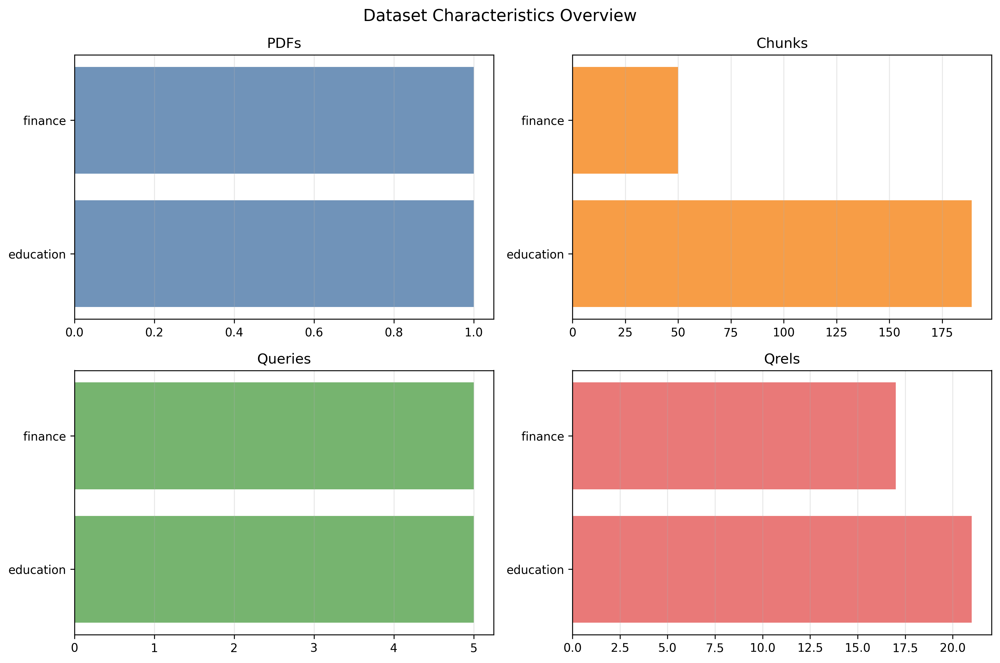
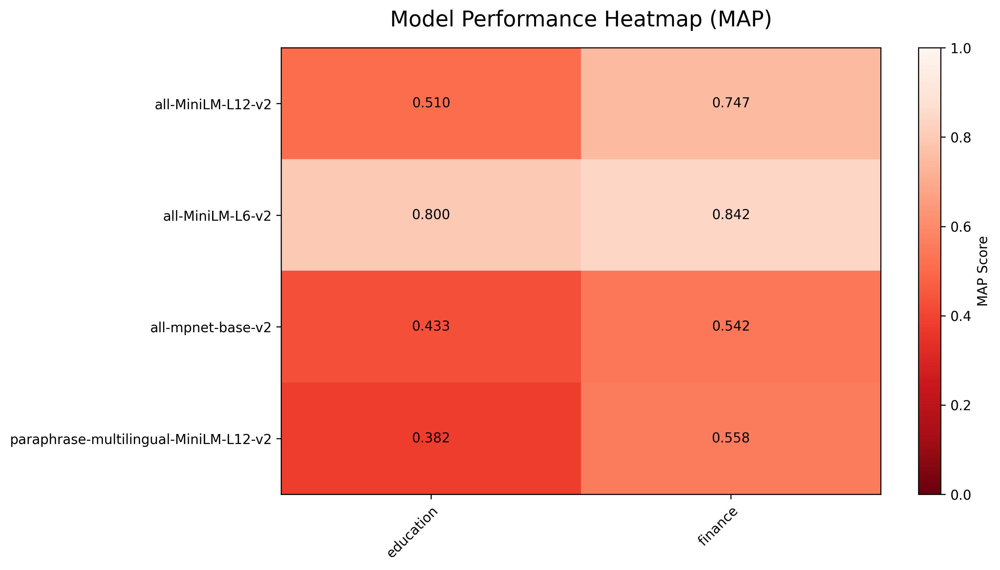
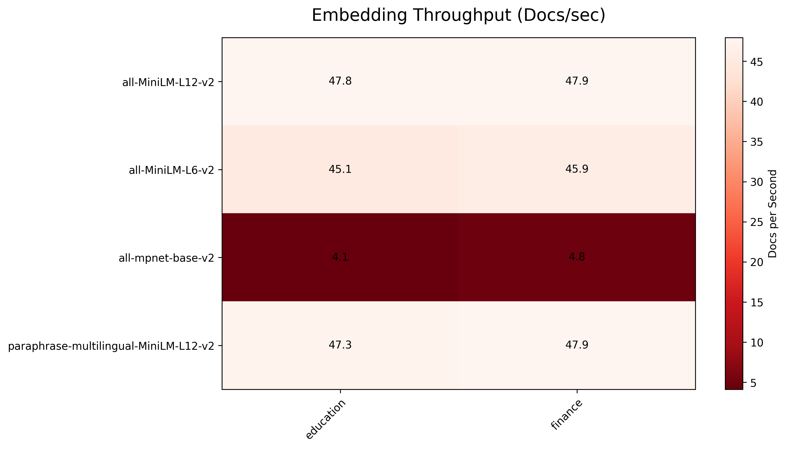
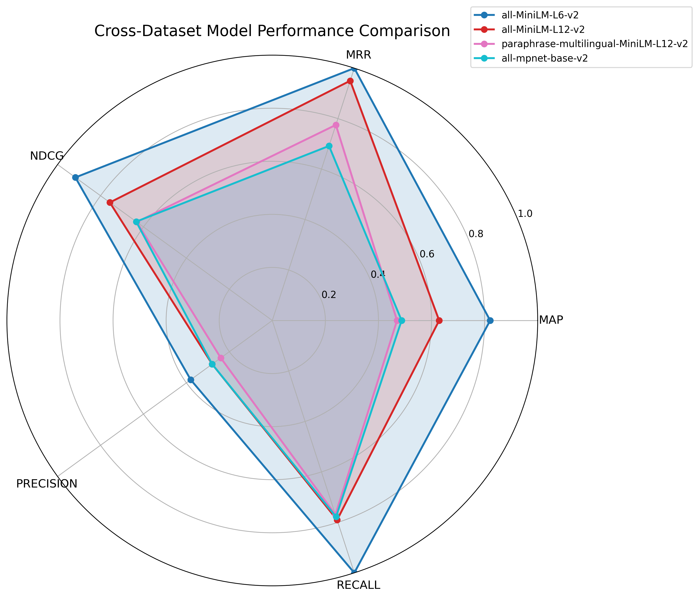
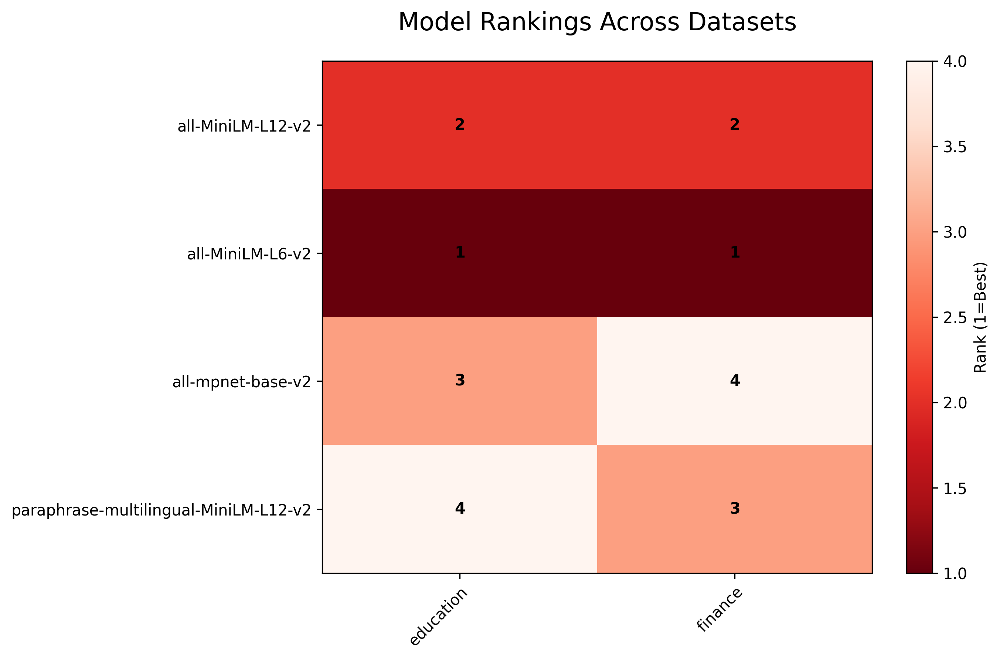
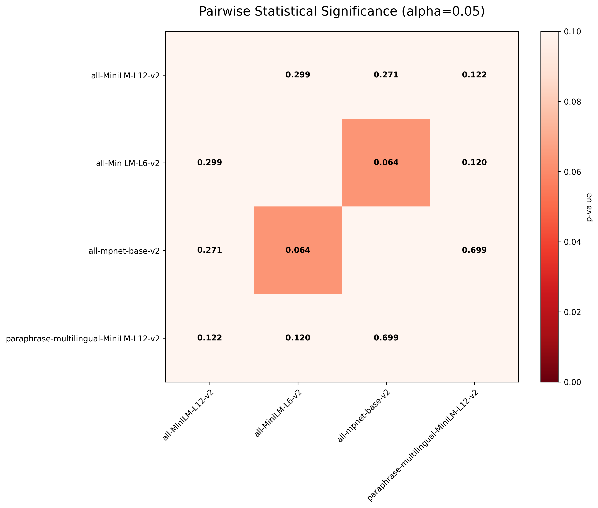
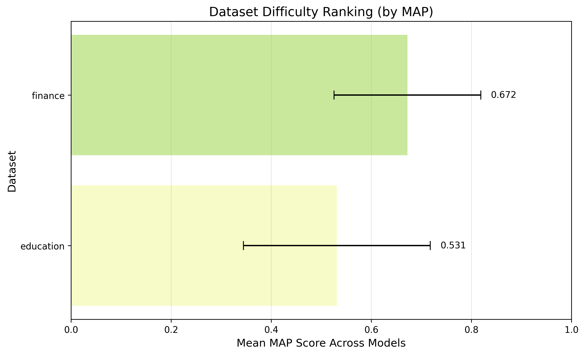
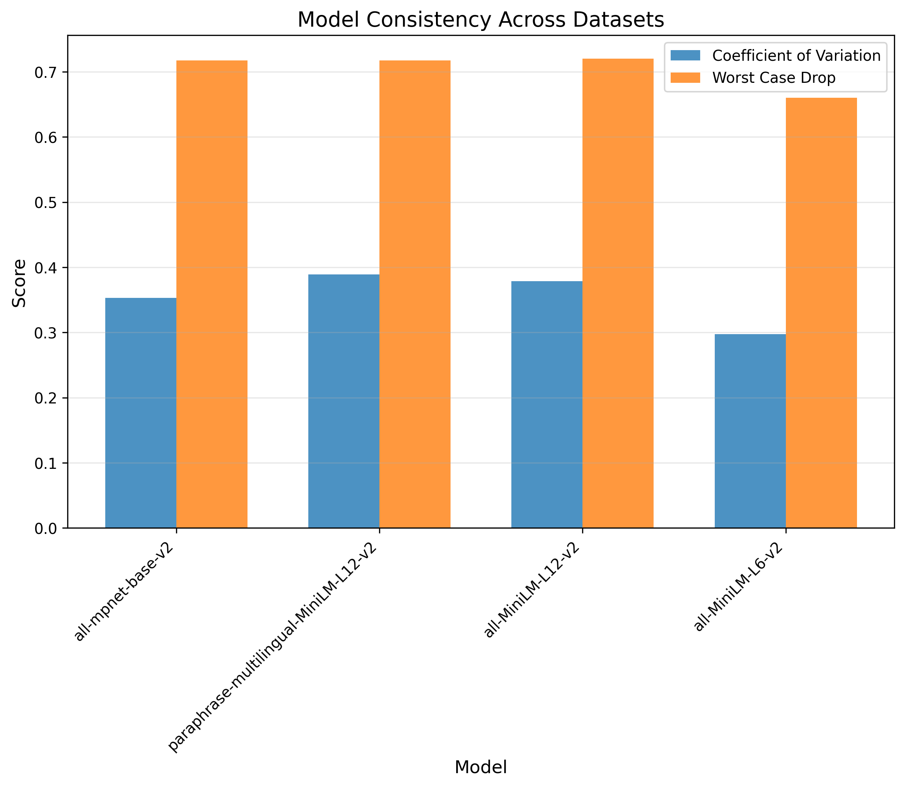

# Cross-Dataset Embedding Model Comparison Report

*Generated: 2026-02-07 16:03:57*

---

## Executive Summary

### Datasets Analyzed

- **education**: 1 PDF → 189 chunks, 5 queries, 21 qrels
- **finance**: 1 PDF → 50 chunks, 5 queries, 17 qrels
- **Total**: 2 datasets, 2 PDFs → 239 chunks, 10 queries

### Overall Best Performers (by Average Rank)

1. **all-MiniLM-L6-v2** (Avg Rank: 1.00)
   - Best on: finance (MAP=0.84), education (MAP=0.80)
   - Consistency: CV=0.297

2. **all-MiniLM-L12-v2** (Avg Rank: 2.00)
   - Best on: finance (MAP=0.75), education (MAP=0.51)
   - Consistency: CV=0.379

3. **all-mpnet-base-v2** (Avg Rank: 3.50)
   - Best on: finance (MAP=0.54), education (MAP=0.43)
   - Consistency: CV=0.353

4. **paraphrase-multilingual-MiniLM-L12-v2** (Avg Rank: 3.50)
   - Best on: finance (MAP=0.56), education (MAP=0.38)
   - Consistency: CV=0.389

### Key Findings

- **Statistical Significance**: all-MiniLM-L6-v2 does not significantly differ from all-MiniLM-L12-v2 on MAP (p=0.299)
- **Dataset Difficulty**: education dataset is harder (mean MAP=0.53 vs finance=0.67)
- **Performance Variability**: all-MiniLM-L6-v2 shows most consistent performance (CV=0.30)

---

## Methodology

### Evaluation Setup

- **Retrieval Method**: ChromaDB vector search with cosine similarity
- **k Value**: 10 (for all metrics)
- **Chunking**: 1000 tokens with 200-token overlap
- **Metrics Computed**: MAP, MRR, NDCG, PRECISION, RECALL

### Statistical Analysis Methods

- **Paired t-tests**: Comparing models across datasets (alpha=0.05)
- **Effect Size**: Cohen's d for practical significance
- **Consistency Metrics**: Coefficient of variation, worst-case drop
- **Friedman Test**: chi-squared=5.40, p=0.145

---

## Dataset Characteristics

| Dataset   |   PDFs |   Chunks |   Queries |   Qrels |
|:----------|-------:|---------:|----------:|--------:|
| education |      1 |      189 |         5 |      21 |
| finance   |      1 |       50 |         5 |      17 |
| Total     |      2 |      239 |        10 |      38 |

**Table: Dataset Statistics Summary**

**Column Explanations:**
- **Dataset**: Dataset identifier used in the benchmark
- **PDFs**: Number of source PDF documents
- **Chunks**: Total text chunks created from PDFs
- **Queries**: Number of evaluation queries generated
- **Qrels**: Number of relevance judgments (query-document labels)

**How to interpret:**
- **More chunks** generally indicate larger corpora and higher retrieval complexity
- **More queries and qrels** increase evaluation coverage and statistical power

| Dataset   |   Avg Chunk Length |   Avg Query Length |   Avg Relevant Docs | Coverage Ratio   |
|:----------|-------------------:|-------------------:|--------------------:|:-----------------|
| education |              158.3 |               12.8 |                 4.2 | 11.11%           |
| finance   |              146.2 |               11.8 |                 3.4 | 34.00%           |
| Average   |              152.3 |               12.3 |                 3.8 | 22.56%           |

**Table: Aggregated Dataset Characteristics**

**Figure: Dataset Characteristics Overview**

This figure compares dataset size indicators (PDFs, chunks, queries, qrels) across all datasets.

---

## Cross-Dataset Model Comparison

### Overall Performance Rankings (by MAP)

| Model                                 |   Avg Rank |   Mean MAP |    Std |    CV |   Datasets Won |
|---------------------------------------|------------|------------|--------|-------|----------------|
| all-MiniLM-L6-v2                      |        1   |     0.8209 | 0.0297 | 0.297 |              2 |
| all-MiniLM-L12-v2                     |        2   |     0.6287 | 0.1678 | 0.379 |              0 |
| all-mpnet-base-v2                     |        3.5 |     0.4872 | 0.077  | 0.353 |              0 |
| paraphrase-multilingual-MiniLM-L12-v2 |        3.5 |     0.4701 | 0.1244 | 0.389 |              0 |

**Table: Cross-Dataset Model Performance Summary**

**Column Explanations:**
- **Avg Rank**: Average ranking position across datasets (1.0 = best overall)
- **Mean MAP**: Average MAP score across all datasets
- **Std**: Standard deviation of performance across datasets
- **CV**: Coefficient of variation (Std/Mean) - measures relative consistency
- **Datasets Won**: Number of datasets where this model ranked #1

**How to use this table:**
- **Sort by Avg Rank**: Identifies the most reliable models overall
- **Check CV values**: Lower CV indicates more consistent performance
- **Compare Mean vs Std**: High mean with low std = reliable excellence
- **Datasets Won**: Shows how often a model is the best choice

### Model Performance by Dataset (MAP)

| Model                                 |   education |   finance |
|---------------------------------------|-------------|-----------|
| all-MiniLM-L12-v2                     |      0.5101 |    0.7474 |
| all-MiniLM-L6-v2                      |      0.7999 |    0.8419 |
| all-mpnet-base-v2                     |      0.4328 |    0.5417 |
| paraphrase-multilingual-MiniLM-L12-v2 |      0.3821 |    0.558  |

**Figure: Model Performance by Dataset**

This heatmap shows MAP scores for each model across all datasets. Darker colors indicate stronger performance.

### Embedding Speed Comparison (Docs/sec)

| Model                                 |   education |   finance |
|---------------------------------------|-------------|-----------|
| all-MiniLM-L12-v2                     |        47.8 |      47.9 |
| all-MiniLM-L6-v2                      |        45.1 |      45.9 |
| all-mpnet-base-v2                     |         4.1 |       4.8 |
| paraphrase-multilingual-MiniLM-L12-v2 |        47.3 |      47.9 |

**Figure: Embedding Throughput by Dataset**

This heatmap compares embedding throughput in documents per second across datasets.

**Figure: Cross-Dataset Performance Comparison**

This radar chart shows how each embedding model performs across all evaluated metrics (MAP, NDCG, etc.) and datasets simultaneously. Each axis represents a different metric, with values normalized to a common scale.

**How to interpret:**
- **Larger area**: Better overall performance across metrics
- **Balanced shape**: Consistent performance across different evaluation aspects
- **Spiky shape**: Strong in some metrics but weak in others
- **Position relative to center**: Distance from center indicates performance level

**Why it matters:** Identifies models with well-rounded capabilities vs. specialized models, helping you choose based on your specific requirements.

**Figure: Model Rankings Across Individual Datasets**

This heatmap displays the ranking position (1=best, higher numbers=worse) of each model within each dataset. Darker colors indicate better performance (lower ranks).

**How to interpret:**
- **Dark horizontal stripes**: Model performs consistently well across datasets
- **Varied colors per model**: Performance varies significantly by dataset
- **Light colors**: Model struggles on those specific datasets
- **Column patterns**: Reveals which datasets are easier/harder for all models

**Why it matters:** Shows model reliability across different domains and identifies specialized vs. general-purpose models.

### Statistical Significance Analysis

This section determines whether observed performance differences between models are statistically significant (real differences) rather than random chance.

**Figure: Statistical Significance of Performance Differences**

This heatmap shows p-values from paired t-tests comparing each model pair across all datasets. Darker colors indicate more significant differences.

**Statistical terms explained:**
- **p-value**: Probability that observed differences occurred by chance
- **alpha**: Significance threshold (0.05 = 5% chance)
- **p < 0.05**: Differences are statistically significant
- **p >= 0.05**: Differences may be due to random variation

**How to interpret:**
- **Dark cells**: Strong evidence that models truly perform differently
- **Light cells**: Models perform similarly (differences likely random)
- **Diagonal**: Always white (comparing model to itself)

**Why it matters:** Ensures you don't choose a model based on noise. Only act on differences that are statistically significant.

**Interpretation Guide**: * p<0.05, ** p<0.01, *** p<0.001, ns = not significant

---

## Dataset-Specific Analysis

### Education Dataset

- **PDFs**: 1 original document
- **Chunks**: 189 text chunks (avg 189.0 per PDF)
- **Queries**: 5 queries, 21 relevance judgments
- **Difficulty**: Medium (mean MAP=0.53 across models)
- **Best Model**: all-MiniLM-L6-v2 (MAP=0.7999)

#### Corpus Characteristics

| Metric                       |   Value |
|:-----------------------------|--------:|
| Source PDF Documents         |     1   |
| Total Document Chunks        |   189   |
| Average Chunk Length (words) |   158.3 |
| Median Chunk Length (words)  |   144   |
| Min Chunk Length (words)     |    67   |
| Max Chunk Length (words)     |   381   |
| Standard Deviation           |    49.5 |

#### Query Characteristics

| Metric                       |   Value |
|:-----------------------------|--------:|
| Total Queries                |     5   |
| Average Query Length (words) |    12.8 |
| Median Query Length (words)  |    12   |
| Min Query Length (words)     |     7   |
| Max Query Length (words)     |    19   |
| Standard Deviation           |     3.9 |

#### Relevance Distribution

| Metric                          | Value   |
|:--------------------------------|:--------|
| Total Relevance Judgments       | 21      |
| Average Relevant Docs per Query | 4.2     |
| Median Relevant Docs per Query  | 4.0     |
| Min Relevant Docs               | 2       |
| Max Relevant Docs               | 9       |
| Coverage Ratio                  | 11.11%  |

#### Representative Query Examples

| Query ID                 | Query Text                                                                                                                       |   # Relevant Docs |
|:-------------------------|:---------------------------------------------------------------------------------------------------------------------------------|------------------:|
| q1_for_DeepSeek_chunk85  | DeepSeek-V3 training hyperparameters and learning rate schedule                                                                  |                 2 |
| q2_for_DeepSeek_chunk109 | What are the methods used to enhance model responses through reflection and verification, and how is non-reasoning data handled? |                 2 |
| q3_for_DeepSeek_chunk21  | What are the key components and training methodologies of the DeepSeek-V3 model?                                                 |                 4 |
| q4_for_DeepSeek_chunk34  | What is the Multi-Token Prediction (MTP) objective and its implementation in DeepSeek-V3?                                        |                 4 |
| q5_for_DeepSeek_chunk52  | What is a mixed precision framework for FP8 data format in deep learning training?                                               |                 9 |

#### Embedding Performance Metrics

| Model                                 |   MAP@10 |   MRR@10 |   NDCG@10 |   PRECISION@10 |   RECALL@10 |
|:--------------------------------------|---------:|---------:|----------:|---------------:|------------:|
| all-MiniLM-L12-v2                     |   0.5101 |   0.9    |    0.6507 |           0.28 |      0.6556 |
| all-MiniLM-L6-v2                      |   0.7999 |   1      |    0.9092 |           0.42 |      1      |
| all-mpnet-base-v2                     |   0.4328 |   0.5333 |    0.5936 |           0.32 |      0.8056 |
| paraphrase-multilingual-MiniLM-L12-v2 |   0.3821 |   0.7167 |    0.558  |           0.24 |      0.6889 |

#### Embedding Speed Comparison

| Model                                 |   Embedding Time (s) |   Docs Processed |   Docs/sec |   Avg Time per Doc (ms) |
|:--------------------------------------|---------------------:|-----------------:|-----------:|------------------------:|
| all-MiniLM-L12-v2                     |                 3.96 |              189 |      47.78 |                   20.93 |
| all-MiniLM-L6-v2                      |                 4.19 |              189 |      45.08 |                   22.18 |
| all-mpnet-base-v2                     |                45.92 |              189 |       4.12 |                  242.96 |
| paraphrase-multilingual-MiniLM-L12-v2 |                 4    |              189 |      47.31 |                   21.14 |

#### Dataset Summary Notes

- Best model: all-MiniLM-L6-v2 (MAP=0.7999)
- Mean MAP across models: 0.5312
- Timing data available for 4 model(s)

### Finance Dataset

- **PDFs**: 1 original document
- **Chunks**: 50 text chunks (avg 50.0 per PDF)
- **Queries**: 5 queries, 17 relevance judgments
- **Difficulty**: Medium (mean MAP=0.67 across models)
- **Best Model**: all-MiniLM-L6-v2 (MAP=0.8419)

#### Corpus Characteristics

| Metric                       |   Value |
|:-----------------------------|--------:|
| Source PDF Documents         |     1   |
| Total Document Chunks        |    50   |
| Average Chunk Length (words) |   146.2 |
| Median Chunk Length (words)  |   145   |
| Min Chunk Length (words)     |    67   |
| Max Chunk Length (words)     |   193   |
| Standard Deviation           |    19.8 |

#### Query Characteristics

| Metric                       |   Value |
|:-----------------------------|--------:|
| Total Queries                |     5   |
| Average Query Length (words) |    11.8 |
| Median Query Length (words)  |    12   |
| Min Query Length (words)     |     6   |
| Max Query Length (words)     |    18   |
| Standard Deviation           |     4.7 |

#### Relevance Distribution

| Metric                          | Value   |
|:--------------------------------|:--------|
| Total Relevance Judgments       | 17      |
| Average Relevant Docs per Query | 3.4     |
| Median Relevant Docs per Query  | 2.0     |
| Min Relevant Docs               | 1       |
| Max Relevant Docs               | 8       |
| Coverage Ratio                  | 34.00%  |

#### Representative Query Examples

| Query ID                 | Query Text                                                                                                      |   # Relevant Docs |
|:-------------------------|:----------------------------------------------------------------------------------------------------------------|------------------:|
| q1_for_Attention_chunk40 | What are some key papers in sequence learning and deep learning, including work on LSTMs and residual networks? |                 4 |
| q2_for_Attention_chunk9  | Transformer model architecture for sequence transduction                                                        |                 8 |
| q3_for_Attention_chunk25 | What are the training data, hardware, and schedule used for language models?                                    |                 1 |
| q4_for_Attention_chunk28 | What are the dropout and label smoothing techniques used in the Transformer model for machine translation?      |                 2 |
| q5_for_Attention_chunk49 | What is the ideal application of law?                                                                           |                 2 |

#### Embedding Performance Metrics

| Model                                 |   MAP@10 |   MRR@10 |   NDCG@10 |   PRECISION@10 |   RECALL@10 |
|:--------------------------------------|---------:|---------:|----------:|---------------:|------------:|
| all-MiniLM-L12-v2                     |   0.7474 |   1      |    0.8627 |           0.28 |       0.925 |
| all-MiniLM-L6-v2                      |   0.8419 |   1      |    0.9252 |           0.34 |       1     |
| all-mpnet-base-v2                     |   0.5417 |   0.85   |    0.6742 |           0.24 |       0.75  |
| paraphrase-multilingual-MiniLM-L12-v2 |   0.558  |   0.8333 |    0.705  |           0.24 |       0.85  |

#### Embedding Speed Comparison

| Model                                 |   Embedding Time (s) |   Docs Processed |   Docs/sec |   Avg Time per Doc (ms) |
|:--------------------------------------|---------------------:|-----------------:|-----------:|------------------------:|
| all-MiniLM-L12-v2                     |                 1.04 |               50 |      47.94 |                   20.86 |
| all-MiniLM-L6-v2                      |                 1.09 |               50 |      45.92 |                   21.78 |
| all-mpnet-base-v2                     |                10.31 |               50 |       4.85 |                  206.23 |
| paraphrase-multilingual-MiniLM-L12-v2 |                 1.04 |               50 |      47.93 |                   20.86 |

#### Dataset Summary Notes

- Best model: all-MiniLM-L6-v2 (MAP=0.8419)
- Mean MAP across models: 0.6723
- Timing data available for 4 model(s)

**Figure: Dataset Difficulty Assessment**

This chart shows the average MAP performance across all models for each dataset. Higher bars indicate easier datasets (better overall performance), lower bars indicate harder datasets.

**How to interpret:**
- **Tall bars**: Datasets where models perform well overall (easier retrieval tasks)
- **Short bars**: Datasets where all models struggle (harder retrieval tasks)
- **Consistent heights**: Similar difficulty across datasets
- **Variable heights**: Some datasets are much harder than others

**Why it matters:** Identifies which datasets are good benchmarks and helps explain why some models might appear better (they excel on easier datasets).

### Dataset Summary

| Dataset   | Best Model       |   Top MAP |   Models Tested |   Difficulty |
|-----------|------------------|-----------|-----------------|--------------|
| education | all-MiniLM-L6-v2 |    0.7999 |               4 |         0.47 |
| finance   | all-MiniLM-L6-v2 |    0.8419 |               4 |         0.33 |

**Table: Dataset Performance Summary**

**Column Explanations:**
- **Dataset**: Name of the dataset evaluated
- **Best Model**: The embedding model that achieved the highest score
- **Top MAP**: The highest MAP score achieved on this dataset
- **Models Tested**: Number of embedding models evaluated
- **Difficulty**: Relative difficulty score (higher = more challenging)

**How to use this table:**
- **Identify dataset characteristics**: Easy datasets have high top scores, hard ones have low scores
- **Model selection guidance**: See which models excel on specific dataset types
- **Benchmark planning**: Use difficulty scores to prioritize dataset development

---

## Model Consistency Across Datasets

This section measures how reliably each model performs across different datasets. A consistent model delivers similar performance regardless of the domain.

**Figure: Model Performance Consistency**

This bar chart shows two key consistency metrics for each model:
- **Coefficient of Variation (CV)**: Standard deviation divided by mean (lower = more consistent)
- **Worst Case Drop**: Maximum performance decrease from best to worst dataset

**How to interpret:**
- **Low CV values**: Model performs similarly across all datasets (reliable)
- **High CV values**: Performance varies greatly by dataset (unreliable)
- **Small worst-case drop**: Model maintains good performance even on hardest datasets
- **Large worst-case drop**: Model fails badly on some datasets

**Why it matters:** For production use, choose models that are consistent across domains rather than models that excel on only specific types of content.

### Detailed Consistency Metrics

| Model                                 |    CV |   Worst Drop |   Score Range |
|---------------------------------------|-------|--------------|---------------|
| all-MiniLM-L6-v2                      | 0.297 |        0.66  |          0.66 |
| all-MiniLM-L12-v2                     | 0.379 |        0.72  |          0.72 |
| all-mpnet-base-v2                     | 0.353 |        0.718 |          0.61 |
| paraphrase-multilingual-MiniLM-L12-v2 | 0.389 |        0.718 |          0.61 |

**Table: Consistency Metrics Explanation**

**Coefficient of Variation (CV)**: Measures relative variability. CV < 0.15 indicates good consistency, CV > 0.30 indicates high variability.

**Worst Case Drop**: Maximum performance decrease from best to worst dataset. Values > 0.3 indicate significant performance degradation on some datasets.

**Score Range**: Total spread between best and worst dataset performance. Smaller ranges indicate more reliable models.

---

## Recommendations

### For Production Deployment

1. **General Purpose**: Use all-MiniLM-L6-v2
   - Best overall performance (avg rank 1.00)
   - Strong performance (mean MAP=0.8209)

### Limitations

- Evaluation limited to 2 datasets
- Single k value (10) - performance may vary at different k
- All datasets are document retrieval tasks
- Statistical power limited by number of datasets

---

## Appendix

### A. Raw Data References

- **education**: `datasets\education\reports\raw_results_2026-02-07_15-14-37.json`
- **finance**: `datasets\finance\reports\raw_results_2026-02-07_15-12-28.json`

### B. Configuration

- Significance Level: alpha = 0.05
- Minimum Datasets Required: 2
- Statistical Tests Enabled: True
- Visualizations Enabled: True

---

*Report generated by RagRetrievalBench Aggregate Reporting System*
