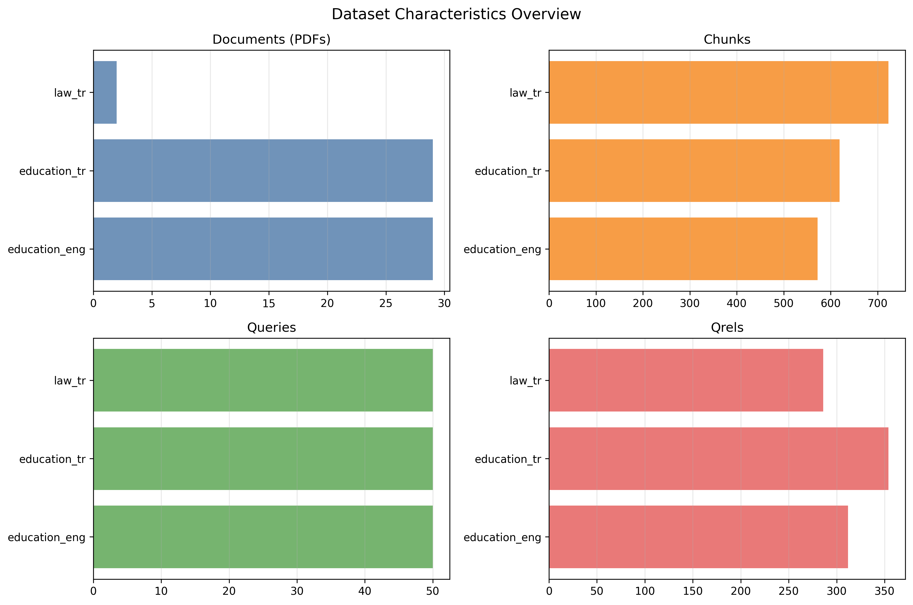
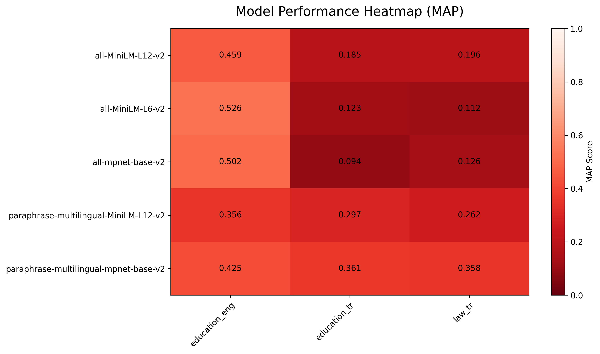
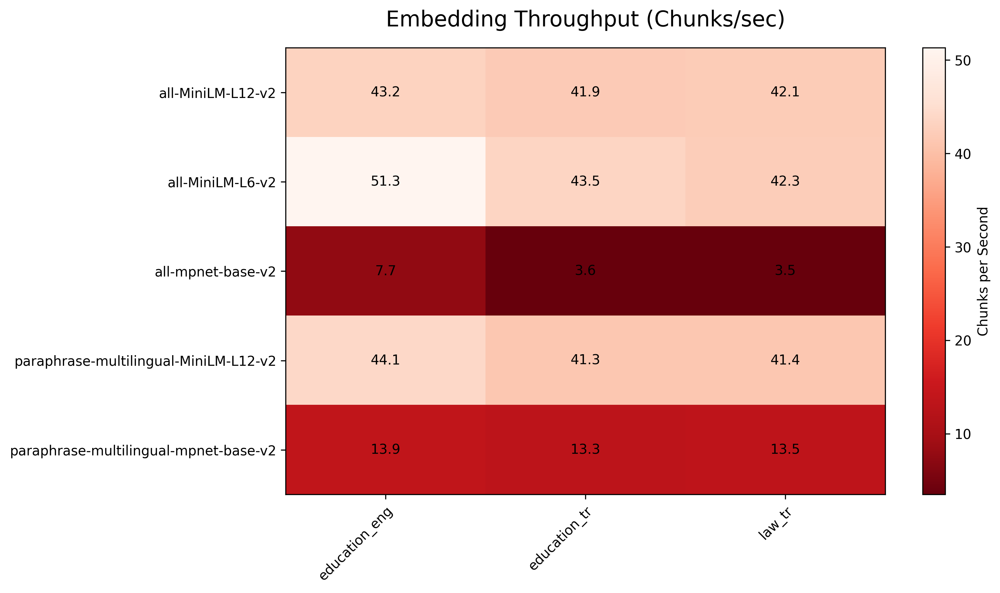
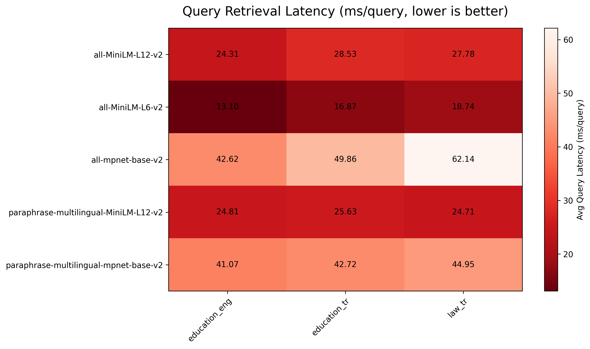
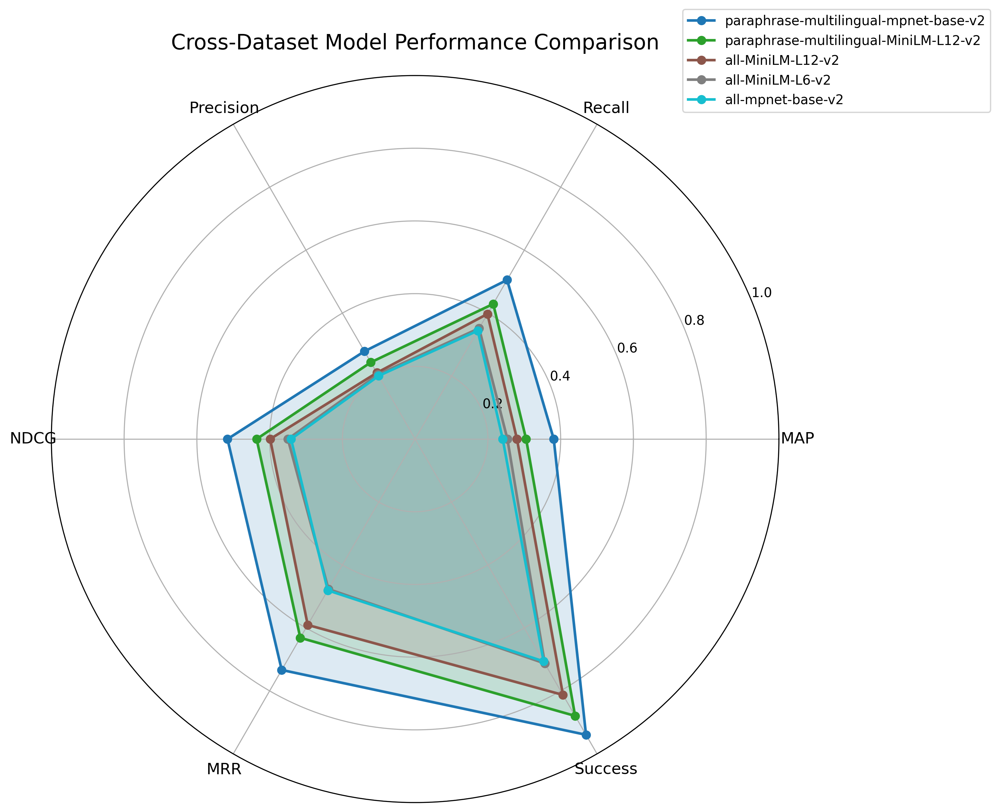
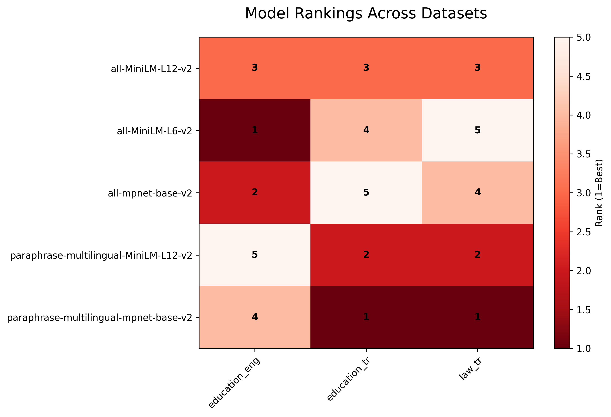
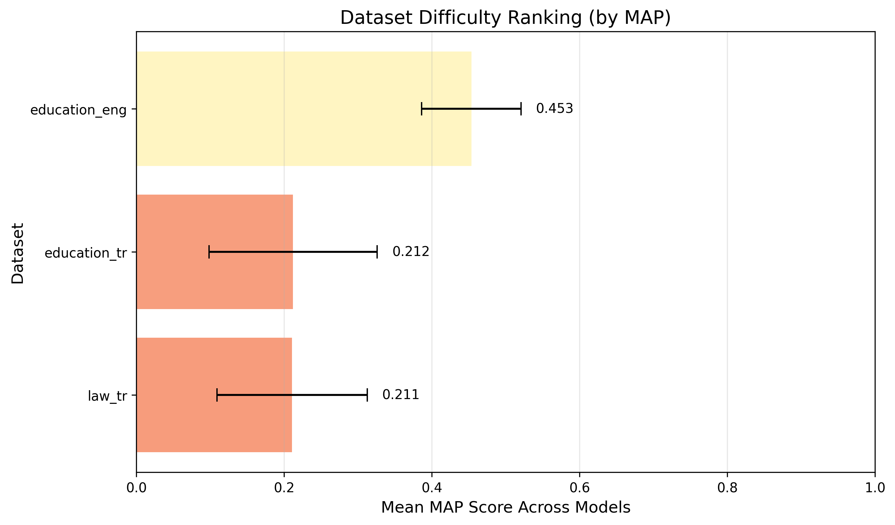
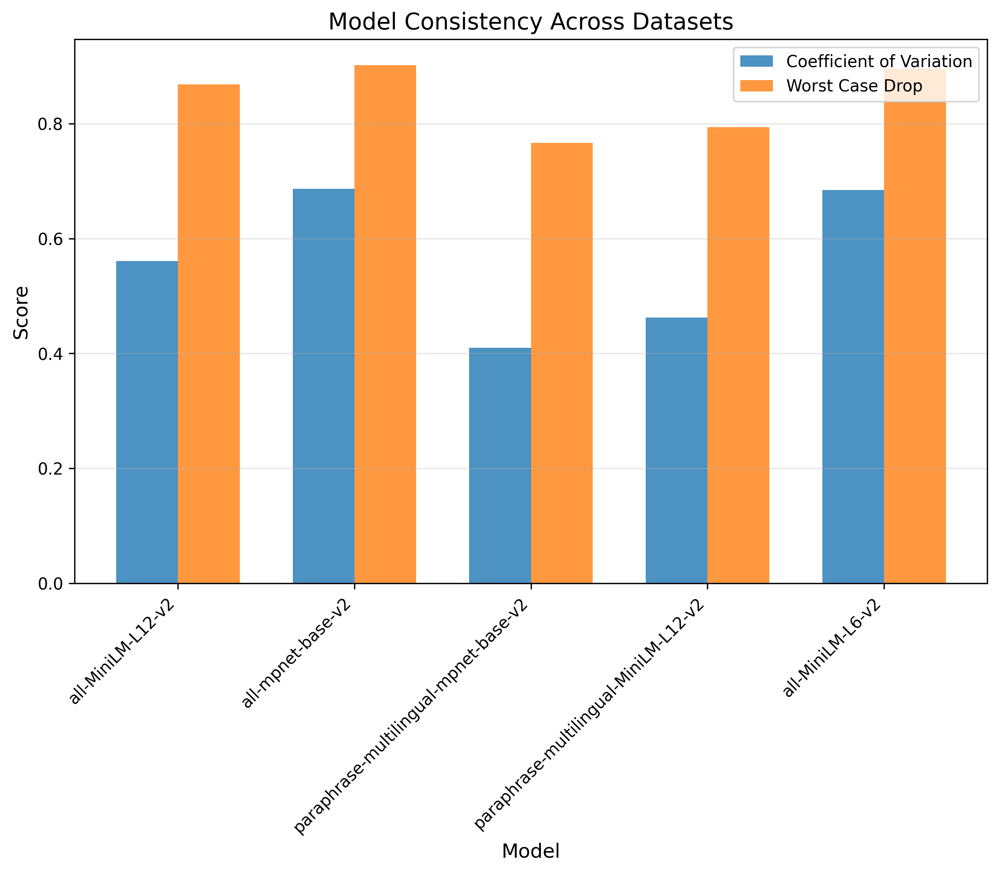

# Cross-Dataset Embedding Model Comparison Report

*Generated: 2026-07-31 15:49:48*

---

## Executive Summary

This report summarizes cross-dataset embedding model performance for Retrieval Augmented Generation (RAG) systems. It aggregates per-dataset benchmark results produced by the pipeline (PDF ingestion → chunking → query generation → qrels creation → embedding evaluation) to identify robust models across domains, not just within a single dataset. Results emphasize both retrieval quality metrics (e.g., MAP, NDCG, MRR) and operational considerations such as embedding throughput and query latency when available.

### Datasets Analyzed

- **education_eng**: 29 documents (PDFs) → 572 chunks, 50 queries, 312 qrels
- **education_tr**: 29 documents (PDFs) → 619 chunks, 50 queries, 354 qrels
- **law_tr**: 2 documents (PDFs) → 723 chunks, 50 queries, 286 qrels
- **Total**: 3 datasets, 60 documents (PDFs) → 1914 chunks, 150 queries

### Overall Best Performers (by Average Rank)

1. **paraphrase-multilingual-mpnet-base-v2** (Avg Rank: 2.00)
   - Best on: education_tr (MAP=0.36), law_tr (MAP=0.36)
   - Consistency: CV=0.410

2. **all-MiniLM-L12-v2** (Avg Rank: 3.00)
   - Leads no dataset; strongest own results: education_eng (MAP=0.46), law_tr (MAP=0.20)
   - Consistency: CV=0.561

3. **paraphrase-multilingual-MiniLM-L12-v2** (Avg Rank: 3.00)
   - Leads no dataset; strongest own results: education_eng (MAP=0.36), education_tr (MAP=0.30)
   - Consistency: CV=0.462

4. **all-MiniLM-L6-v2** (Avg Rank: 3.33)
   - Best on: education_eng (MAP=0.53)
   - Consistency: CV=0.684

5. **all-mpnet-base-v2** (Avg Rank: 3.67)
   - Leads no dataset; strongest own results: education_eng (MAP=0.50), law_tr (MAP=0.13)
   - Consistency: CV=0.686

### Key Findings

- **Statistical Significance**: paraphrase-multilingual-mpnet-base-v2 does not significantly differ from all-MiniLM-L12-v2 on MAP (p=0.274)
- **Dataset Difficulty**: law_tr dataset is harder (mean MAP=0.21 vs education_eng=0.45)
- **Performance Variability**: paraphrase-multilingual-mpnet-base-v2 shows most consistent performance (CV=0.41)

---

## Methodology

### Evaluation Setup

- **Retrieval Method**: ChromaDB vector search (l2 distance space; similarity 1/(1+d))
- **k Value**: 10 (for all metrics)
- **Chunking**: 1000 characters with 200-character overlap
- **Metrics Computed**: MAP, Recall, Precision, NDCG, MRR, Success/Hit Rate

### Statistical Analysis Methods

- **Query-level bootstrap**: Confidence intervals over individual queries (see *Query-Level Uncertainty* below)
- **Consistency Metrics**: Coefficient of variation, worst-case drop

> Dataset-level significance tests (Friedman, paired t-tests, Cohen's *d*) are not reported. They treat each of the 3 dataset means as one observation and therefore have almost no power at this scale. The query-level bootstrap below replaces them. Set `aggregate_report_dataset_level_tests = True` in `config.py` to emit them anyway.

---

## Dataset Characteristics

| Dataset       |   Documents (PDFs) |   Chunks |   Queries |   Qrels |
|:--------------|-------------------:|---------:|----------:|--------:|
| education_eng |                 29 |      572 |        50 |     312 |
| education_tr  |                 29 |      619 |        50 |     354 |
| law_tr        |                  2 |      723 |        50 |     286 |
| Total         |                 60 |     1914 |       150 |     952 |

**Table: Dataset Statistics Summary**

**Column Explanations:**
- **Dataset**: Dataset identifier used in the benchmark
- **Documents (PDFs)**: Number of source documents (PDF files)
- **Chunks**: Total text chunks created from documents (PDFs)
- **Queries**: Number of evaluation queries generated
- **Qrels**: Number of relevance judgments (query-document labels)

**How to interpret:**
- **More chunks** generally indicate larger corpora and higher retrieval complexity
- **More queries and qrels** increase evaluation coverage and statistical power

**Figure: Dataset Characteristics Overview**

This figure compares dataset size indicators (documents (PDFs), chunks, queries, qrels) across all datasets.

| Dataset       |   Avg Chunk Length (words) |   Avg Query Length (words) |   Avg Relevant Documents | Coverage Ratio   |
|:--------------|---------------------------:|---------------------------:|-------------------------:|:-----------------|
| education_eng |                      143   |                       13.5 |                      6.5 | 54.55%           |
| education_tr  |                      116   |                        9.4 |                      7.1 | 57.19%           |
| law_tr        |                      121.2 |                       10   |                      5.7 | 39.56%           |
| Average       |                      126.7 |                       11   |                      6.4 | 50.43%           |

**Table: Aggregated Dataset Characteristics**

---

## Cross-Dataset Model Comparison

### Overall Performance Rankings (by MAP)

| Model                                 |   Avg Rank |   Mean MAP |    Std |    CV |   Datasets Won |
|---------------------------------------|------------|------------|--------|-------|----------------|
| paraphrase-multilingual-mpnet-base-v2 |       2    |     0.381  | 0.0378 | 0.41  |              2 |
| all-MiniLM-L12-v2                     |       3    |     0.2799 | 0.1549 | 0.561 |              0 |
| paraphrase-multilingual-MiniLM-L12-v2 |       3    |     0.3051 | 0.0472 | 0.462 |              0 |
| all-MiniLM-L6-v2                      |       3.33 |     0.2536 | 0.236  | 0.684 |              1 |
| all-mpnet-base-v2                     |       3.67 |     0.2408 | 0.2269 | 0.686 |              0 |

**Table: Cross-Dataset Model Performance Summary**

**Column Explanations:**
- **Avg Rank**: Average ranking position across datasets (1.0 = best overall)
- **Mean MAP**: Average MAP score across all datasets
- **Std**: Standard deviation of performance across datasets
- **CV**: Coefficient of variation (Std/Mean) - measures relative consistency
- **Datasets Won**: Number of datasets where this model ranked #1

**How to use this table:**
- **Sort by Avg Rank**: Identifies the most reliable models overall
- **Check CV values**: Lower CV indicates more consistent performance
- **Compare Mean vs Std**: High mean with low std = reliable excellence
- **Datasets Won**: Shows how often a model is the best choice

### Model Performance by Dataset (MAP)

**Figure: Model Performance by Dataset**

This heatmap shows MAP scores for each model across all datasets. Darker colors indicate lower scores (weaker performance).

| Model                                 |   education_eng |   education_tr |   law_tr |
|---------------------------------------|-----------------|----------------|----------|
| all-MiniLM-L12-v2                     |          0.4587 |         0.1854 |   0.1956 |
| all-MiniLM-L6-v2                      |          0.526  |         0.1231 |   0.1117 |
| all-mpnet-base-v2                     |          0.5022 |         0.094  |   0.1263 |
| paraphrase-multilingual-MiniLM-L12-v2 |          0.3557 |         0.2972 |   0.2624 |
| paraphrase-multilingual-mpnet-base-v2 |          0.4246 |         0.3606 |   0.3577 |

**Table: Model Performance by Dataset (MAP@10)**

### Embedding Speed Comparison (Chunks/sec)

**Figure: Embedding Throughput by Dataset**

This heatmap compares embedding throughput in chunks per second across datasets.

| Model                                 |   education_eng |   education_tr |   law_tr |
|---------------------------------------|-----------------|----------------|----------|
| all-MiniLM-L12-v2                     |            43.2 |           41.9 |     42.1 |
| all-MiniLM-L6-v2                      |            51.3 |           43.5 |     42.3 |
| all-mpnet-base-v2                     |             7.7 |            3.6 |      3.5 |
| paraphrase-multilingual-MiniLM-L12-v2 |            44.1 |           41.3 |     41.4 |
| paraphrase-multilingual-mpnet-base-v2 |            13.9 |           13.3 |     13.5 |

**Table: Embedding Throughput by Dataset (Chunks/sec)**

### Query Retrieval Latency Comparison (ms/query)

Lower values are better. Latency is measured during `collection.query(...)` only.

**Figure: Query Retrieval Latency by Dataset**

This heatmap compares average retrieval latency in ms/query across datasets (lower is better).

| Model                                 |   education_eng |   education_tr |   law_tr |
|---------------------------------------|-----------------|----------------|----------|
| all-MiniLM-L12-v2                     |           24.31 |          28.53 |    27.78 |
| all-MiniLM-L6-v2                      |           13.1  |          16.87 |    18.74 |
| all-mpnet-base-v2                     |           42.62 |          49.86 |    62.14 |
| paraphrase-multilingual-MiniLM-L12-v2 |           24.81 |          25.63 |    24.71 |
| paraphrase-multilingual-mpnet-base-v2 |           41.07 |          42.72 |    44.95 |

**Table: Query Retrieval Latency by Dataset (ms/query)**

| Model                                 |   Weighted Mean Latency (ms/query) |   Best (Min) |   Worst (Max) |   Datasets with Latency Data |   Total Queries Timed |
|---------------------------------------|------------------------------------|--------------|---------------|------------------------------|-----------------------|
| all-MiniLM-L6-v2                      |                              16.28 |        13.1  |         18.74 |                            3 |                   148 |
| paraphrase-multilingual-MiniLM-L12-v2 |                              25.05 |        24.71 |         25.63 |                            3 |                   148 |
| all-MiniLM-L12-v2                     |                              26.91 |        24.31 |         28.53 |                            3 |                   148 |
| paraphrase-multilingual-mpnet-base-v2 |                              42.94 |        41.07 |         44.95 |                            3 |                   148 |
| all-mpnet-base-v2                     |                              51.66 |        42.62 |         62.14 |                            3 |                   148 |

**Table: Weighted Query Latency Summary**

**Figure: Cross-Dataset Performance Comparison**

This radar chart shows how each embedding model performs across all evaluated metrics (MAP, NDCG, etc.) and datasets simultaneously. Each axis represents a different metric, with values normalized to a common scale.

**How to interpret:**
- **Larger area**: Better overall performance across metrics
- **Balanced shape**: Consistent performance across different evaluation aspects
- **Spiky shape**: Strong in some metrics but weak in others
- **Position relative to center**: Distance from center indicates performance level

**Why it matters:** Identifies models with well-rounded capabilities vs. specialized models, helping you choose based on your specific requirements.

**Figure: Model Rankings Across Individual Datasets**

This heatmap displays the ranking position (1=best, higher numbers=worse) of each model within each dataset. Darker colors indicate better performance (lower ranks).

**How to interpret:**
- **Dark horizontal stripes**: Model performs consistently well across datasets
- **Varied colors per model**: Performance varies significantly by dataset
- **Light colors**: Model struggles on those specific datasets
- **Column patterns**: Reveals which datasets are easier/harder for all models

**Why it matters:** Shows model reliability across different domains and identifies specialized vs. general-purpose models.

---

## Query-Level Uncertainty (Descriptive)

Everything above is a point estimate. This section resamples the individual queries to show how far each MAP@10 estimate moves under that resampling, and whether the pooled query evidence actually separates the candidate models.

The scored queries of all 3 corpora are concatenated into a single pool of 148 queries, and every interval is a percentile bootstrap with B=10,000 resamples. `M5` is the pooled MAP@10 leader and is the model the paired column compares against.

| Model                                        | MAP@10 [95% CI]         | `M5` - model diff [95% CI]   | Separated?   |
|:---------------------------------------------|:------------------------|:-----------------------------|:-------------|
| paraphrase-multilingual-mpnet-base-v2 (`M5`) | 0.3804 [0.3366, 0.4261] | -                            | -            |
| paraphrase-multilingual-MiniLM-L12-v2 (`M3`) | 0.3044 [0.2651, 0.3460] | +0.0760 [+0.0448, +0.1080]   | yes          |
| all-MiniLM-L12-v2 (`M4`)                     | 0.2775 [0.2354, 0.3205] | +0.1029 [+0.0555, +0.1530]   | yes          |
| all-MiniLM-L6-v2 (`M1`)                      | 0.2499 [0.2072, 0.2945] | +0.1305 [+0.0781, +0.1831]   | yes          |
| all-mpnet-base-v2 (`M2`)                     | 0.2373 [0.1941, 0.2823] | +0.1431 [+0.0872, +0.1997]   | yes          |

**Table: Pooled bootstrap intervals for MAP@10 (B=10,000 resamples over 148 scored queries from 3 corpora)**

**How to interpret:**
- **Estimator**: these means are a **pooled mean over all scored queries**, not the unweighted macro mean of the per-dataset means reported in the *Cross-Dataset Model Comparison* table above. Here each corpus contributes in proportion to its query count, so the two aggregate numbers for the same model differ slightly. That is expected, not an inconsistency.
- **Unstratified resampling**: each resample draws uniformly from the flat concatenated per-query vector and does **not** preserve each corpus's share of the queries. Between-corpus composition variance is therefore folded into the interval widths, making these intervals wider than a within-corpus interval computed on the same number of queries.
- **The paired column is the one that discriminates.** It resamples the per-query differences, which cancels the shared query difficulty that inflates every model's own interval. Two marginal intervals can overlap heavily while the paired difference still excludes zero, so overlap in the middle column is **not** evidence of no difference.
- **Separated? = no** means the pooled query evidence does not distinguish that model from `M5` on MAP@10. When that happens, decide on operational cost (embedding throughput, query latency) rather than on retrieval quality.
- **Scope**: the per-corpus intervals live in each dataset's own benchmark report, under its *Query-Level Uncertainty* section. Because a deployment targets one corpus at a time, the **corpus-level report is the primary artifact for model selection**; this pooled view is a descriptive cross-corpus summary, not population-level inference.

---

## Dataset-Specific Analysis

### Education_eng Dataset

- **Documents (PDFs)**: 29 original documents
- **Chunks**: 572 text chunks (avg 19.7 per document (PDF))
- **Queries**: 50 queries, 312 relevance judgments
- **Difficulty**: Hard (mean MAP=0.45 across models)
- **Best Model**: all-MiniLM-L6-v2 (MAP=0.5260)

#### Corpus Characteristics

| Metric                       |   Value |
|:-----------------------------|--------:|
| Source Documents (PDFs)      |    29   |
| Total Chunks                 |   572   |
| Average Chunk Length (words) |   143   |
| Median Chunk Length (words)  |   145   |
| Min Chunk Length (words)     |    18   |
| Max Chunk Length (words)     |   173   |
| Standard Deviation           |    17.4 |

**Table: Corpus Characteristics (Education_eng Dataset)**

#### Query Characteristics

| Metric                       |   Value |
|:-----------------------------|--------:|
| Total Queries                |    50   |
| Average Query Length (words) |    13.5 |
| Median Query Length (words)  |    13.5 |
| Min Query Length (words)     |     7   |
| Max Query Length (words)     |    24   |
| Standard Deviation           |     3.1 |

**Table: Query Characteristics (Education_eng Dataset)**

#### Relevance Distribution

| Metric                               | Value   |
|:-------------------------------------|:--------|
| Total Relevance Judgments            | 312     |
| Average Relevant Documents per Query | 6.5     |
| Median Relevant Documents per Query  | 5.0     |
| Min Relevant Documents               | 1       |
| Max Relevant Documents               | 22      |
| Coverage Ratio                       | 54.55%  |

**Table: Relevance Distribution (Education_eng Dataset)**

#### Representative Query Examples

| Query ID                | Query Text                                                                                                                       |   # Relevant Documents |
|:------------------------|:---------------------------------------------------------------------------------------------------------------------------------|-----------------------:|
| q1_for_English_chunk24  | What are the requirements for students to pass each level and advance in the ELS program?                                        |                      6 |
| q2_for_Barriers_chunk8  | What are the responsibilities of instructors regarding disabled students and coordination with the "TEDU Without Barriers" Unit? |                      3 |
| q3_for_PartTime_chunk6  | What are the procedures and requirements for part-time student employment at TED University?                                     |                      5 |
| q4_for_mobility_chunk24 | What constitutes a force majeure event in contractual agreements?                                                                |                      7 |
| q5_for_mobility_chunk2  | Erasmus+ program details for student mobility and application timeline.                                                          |                     22 |

**Table: Representative Queries (Education_eng Dataset)**

#### Embedding Performance Metrics

| Model                                 |   MAP@10 |   Recall@10 |   Precision@10 |   NDCG@10 |   MRR@10 |   Success@10 |
|:--------------------------------------|---------:|------------:|---------------:|----------:|---------:|-------------:|
| all-MiniLM-L12-v2                     |   0.4587 |      0.6065 |         0.3375 |    0.615  |   0.8392 |       0.9583 |
| all-MiniLM-L6-v2                      |   0.526  |      0.6529 |         0.3688 |    0.6626 |   0.8325 |       0.9583 |
| all-mpnet-base-v2                     |   0.5022 |      0.618  |         0.3542 |    0.6405 |   0.8398 |       0.9583 |
| paraphrase-multilingual-MiniLM-L12-v2 |   0.3557 |      0.5087 |         0.2771 |    0.499  |   0.6867 |       0.9583 |
| paraphrase-multilingual-mpnet-base-v2 |   0.4246 |      0.5384 |         0.3042 |    0.5595 |   0.7757 |       0.9583 |

**Table: Embedding Performance Metrics (Education_eng Dataset)**

#### Compute and Retrieval Timing

| Model                                 |   Embedding Time (s) |   Chunks Processed |   Chunks/sec |   Avg Time per Chunk (ms) |   Avg Query Latency (ms/query) |   Queries Timed |
|:--------------------------------------|---------------------:|-------------------:|-------------:|--------------------------:|-------------------------------:|----------------:|
| all-MiniLM-L12-v2                     |                13.24 |                572 |        43.19 |                     23.15 |                          24.31 |              48 |
| all-MiniLM-L6-v2                      |                11.15 |                572 |        51.31 |                     19.49 |                          13.1  |              48 |
| all-mpnet-base-v2                     |                74.17 |                572 |         7.71 |                    129.66 |                          42.62 |              48 |
| paraphrase-multilingual-MiniLM-L12-v2 |                12.97 |                572 |        44.09 |                     22.68 |                          24.81 |              48 |
| paraphrase-multilingual-mpnet-base-v2 |                41.27 |                572 |        13.86 |                     72.16 |                          41.07 |              48 |

**Table: Compute and Retrieval Timing (Education_eng Dataset)**

#### Dataset Summary Notes

- Best model: all-MiniLM-L6-v2 (MAP=0.5260)
- Mean MAP across models: 0.4534
- Timing data available for 5 model(s)

### Education_tr Dataset

- **Documents (PDFs)**: 29 original documents
- **Chunks**: 619 text chunks (avg 21.3 per document (PDF))
- **Queries**: 50 queries, 354 relevance judgments
- **Difficulty**: Hard (mean MAP=0.21 across models)
- **Best Model**: paraphrase-multilingual-mpnet-base-v2 (MAP=0.3606)

#### Corpus Characteristics

| Metric                       |   Value |
|:-----------------------------|--------:|
| Source Documents (PDFs)      |    29   |
| Total Chunks                 |   619   |
| Average Chunk Length (words) |   116   |
| Median Chunk Length (words)  |   119   |
| Min Chunk Length (words)     |    16   |
| Max Chunk Length (words)     |   144   |
| Standard Deviation           |    15.8 |

**Table: Corpus Characteristics (Education_tr Dataset)**

#### Query Characteristics

| Metric                       |   Value |
|:-----------------------------|--------:|
| Total Queries                |    50   |
| Average Query Length (words) |     9.4 |
| Median Query Length (words)  |     9   |
| Min Query Length (words)     |     5   |
| Max Query Length (words)     |    23   |
| Standard Deviation           |     3.1 |

**Table: Query Characteristics (Education_tr Dataset)**

#### Relevance Distribution

| Metric                               | Value   |
|:-------------------------------------|:--------|
| Total Relevance Judgments            | 354     |
| Average Relevant Documents per Query | 7.1     |
| Median Relevant Documents per Query  | 6.0     |
| Min Relevant Documents               | 2       |
| Max Relevant Documents               | 20      |
| Coverage Ratio                       | 57.19%  |

**Table: Relevance Distribution (Education_tr Dataset)**

#### Representative Query Examples

| Query ID                    | Query Text                                                               |   # Relevant Documents |
|:----------------------------|:-------------------------------------------------------------------------|-----------------------:|
| q1_for_Bütçe_chunk2         | TED Üniversitesi bütçe ve muhasebe esasları nelerdir?                    |                      6 |
| q2_for_Atama_chunk26        | TEDÜ doçentlik atama kriterleri nelerdir?                                |                     11 |
| q3_for_Kaf_chunk15          | Yönerge güncellemeleri ve revizyonları hakkında bilgi.                   |                     20 |
| q4_for_hareketlilik_chunk26 | Yeşil seyahat ve Erasmus+ ikili anlaşmaları hakkında bilgi.              |                      8 |
| q5_for_hareketlilik_chunk4  | Erasmus+ öğrenim hareketliliği başvuru süreci ve takvimi hakkında bilgi. |                      9 |

**Table: Representative Queries (Education_tr Dataset)**

#### Embedding Performance Metrics

| Model                                 |   MAP@10 |   Recall@10 |   Precision@10 |   NDCG@10 |   MRR@10 |   Success@10 |
|:--------------------------------------|---------:|------------:|---------------:|----------:|---------:|-------------:|
| all-MiniLM-L12-v2                     |   0.1854 |      0.2579 |          0.168 |    0.2951 |   0.5345 |         0.72 |
| all-MiniLM-L6-v2                      |   0.1231 |      0.1897 |          0.146 |    0.1956 |   0.2788 |         0.58 |
| all-mpnet-base-v2                     |   0.094  |      0.1913 |          0.136 |    0.1766 |   0.2561 |         0.58 |
| paraphrase-multilingual-MiniLM-L12-v2 |   0.2972 |      0.3953 |          0.256 |    0.4259 |   0.6369 |         0.88 |
| paraphrase-multilingual-mpnet-base-v2 |   0.3606 |      0.4876 |          0.308 |    0.5067 |   0.759  |         0.96 |

**Table: Embedding Performance Metrics (Education_tr Dataset)**

#### Compute and Retrieval Timing

| Model                                 |   Embedding Time (s) |   Chunks Processed |   Chunks/sec |   Avg Time per Chunk (ms) |   Avg Query Latency (ms/query) |   Queries Timed |
|:--------------------------------------|---------------------:|-------------------:|-------------:|--------------------------:|-------------------------------:|----------------:|
| all-MiniLM-L12-v2                     |                14.76 |                619 |        41.94 |                     23.84 |                          28.53 |              50 |
| all-MiniLM-L6-v2                      |                14.24 |                619 |        43.47 |                     23    |                          16.87 |              50 |
| all-mpnet-base-v2                     |               172.18 |                619 |         3.6  |                    278.16 |                          49.86 |              50 |
| paraphrase-multilingual-MiniLM-L12-v2 |                14.97 |                619 |        41.34 |                     24.19 |                          25.63 |              50 |
| paraphrase-multilingual-mpnet-base-v2 |                46.63 |                619 |        13.27 |                     75.33 |                          42.72 |              50 |

**Table: Compute and Retrieval Timing (Education_tr Dataset)**

#### Dataset Summary Notes

- Best model: paraphrase-multilingual-mpnet-base-v2 (MAP=0.3606)
- Mean MAP across models: 0.2121
- Timing data available for 5 model(s)

### Law_tr Dataset

- **Documents (PDFs)**: 2 original documents
- **Chunks**: 723 text chunks (avg 361.5 per document (PDF))
- **Queries**: 50 queries, 286 relevance judgments
- **Difficulty**: Hard (mean MAP=0.21 across models)
- **Best Model**: paraphrase-multilingual-mpnet-base-v2 (MAP=0.3577)

#### Corpus Characteristics

| Metric                       |   Value |
|:-----------------------------|--------:|
| Source Documents (PDFs)      |     2   |
| Total Chunks                 |   723   |
| Average Chunk Length (words) |   121.2 |
| Median Chunk Length (words)  |   121   |
| Min Chunk Length (words)     |    56   |
| Max Chunk Length (words)     |   214   |
| Standard Deviation           |    11.1 |

**Table: Corpus Characteristics (Law_tr Dataset)**

#### Query Characteristics

| Metric                       |   Value |
|:-----------------------------|--------:|
| Total Queries                |    50   |
| Average Query Length (words) |    10   |
| Median Query Length (words)  |     9   |
| Min Query Length (words)     |     5   |
| Max Query Length (words)     |    20   |
| Standard Deviation           |     2.8 |

**Table: Query Characteristics (Law_tr Dataset)**

#### Relevance Distribution

| Metric                               | Value   |
|:-------------------------------------|:--------|
| Total Relevance Judgments            | 286     |
| Average Relevant Documents per Query | 5.7     |
| Median Relevant Documents per Query  | 4.5     |
| Min Relevant Documents               | 1       |
| Max Relevant Documents               | 20      |
| Coverage Ratio                       | 39.56%  |

**Table: Relevance Distribution (Law_tr Dataset)**

#### Representative Query Examples

| Query ID                   | Query Text                                                                                                                                                                              |   # Relevant Documents |
|:---------------------------|:----------------------------------------------------------------------------------------------------------------------------------------------------------------------------------------|-----------------------:|
| q1_for_Sermaye_chunk238    | Sermaye piyasası kurumlarında daire başkanlıklarının oluşturulması, kapatılması ve birleştirilmesi ile yurt içi ve yurt dışı temsilciliklerin açılmasına ilişkin düzenlemeler nelerdir? |                      1 |
| q2_for_Bankacılık_chunk115 | Müşteri sırlarının korunması ve paylaşımına ilişkin yasal düzenlemeler nelerdir?                                                                                                        |                      8 |
| q3_for_Bankacılık_chunk26  | Faaliyet izninin iptali veya sınırlandırılmasına ilişkin durumlar nelerdir?                                                                                                             |                     11 |
| q4_for_Bankacılık_chunk282 | Ticarî ve iktisadî bütünlük oluşturan mal varlıklarının satış usulleri ve ihale bedelinin dağıtımı.                                                                                     |                      9 |
| q5_for_Bankacılık_chunk251 | 703 sayılı KHK ile yapılan değişiklikler nelerdir?                                                                                                                                      |                     18 |

**Table: Representative Queries (Law_tr Dataset)**

#### Embedding Performance Metrics

| Model                                 |   MAP@10 |   Recall@10 |   Precision@10 |   NDCG@10 |   MRR@10 |   Success@10 |
|:--------------------------------------|---------:|------------:|---------------:|----------:|---------:|-------------:|
| all-MiniLM-L12-v2                     |   0.1956 |      0.3278 |          0.126 |    0.286  |   0.398  |         0.76 |
| all-MiniLM-L6-v2                      |   0.1117 |      0.2125 |          0.1   |    0.1915 |   0.3185 |         0.6  |
| all-mpnet-base-v2                     |   0.1263 |      0.2235 |          0.112 |    0.2065 |   0.3457 |         0.58 |
| paraphrase-multilingual-MiniLM-L12-v2 |   0.2624 |      0.3836 |          0.198 |    0.3825 |   0.5707 |         0.8  |
| paraphrase-multilingual-mpnet-base-v2 |   0.3577 |      0.4903 |          0.224 |    0.4815 |   0.6659 |         0.9  |

**Table: Embedding Performance Metrics (Law_tr Dataset)**

#### Compute and Retrieval Timing

| Model                                 |   Embedding Time (s) |   Chunks Processed |   Chunks/sec |   Avg Time per Chunk (ms) |   Avg Query Latency (ms/query) |   Queries Timed |
|:--------------------------------------|---------------------:|-------------------:|-------------:|--------------------------:|-------------------------------:|----------------:|
| all-MiniLM-L12-v2                     |                17.16 |                723 |        42.14 |                     23.73 |                          27.78 |              50 |
| all-MiniLM-L6-v2                      |                17.1  |                723 |        42.27 |                     23.66 |                          18.74 |              50 |
| all-mpnet-base-v2                     |               206.64 |                723 |         3.5  |                    285.8  |                          62.14 |              50 |
| paraphrase-multilingual-MiniLM-L12-v2 |                17.46 |                723 |        41.41 |                     24.15 |                          24.71 |              50 |
| paraphrase-multilingual-mpnet-base-v2 |                53.68 |                723 |        13.47 |                     74.24 |                          44.95 |              50 |

**Table: Compute and Retrieval Timing (Law_tr Dataset)**

#### Dataset Summary Notes

- Best model: paraphrase-multilingual-mpnet-base-v2 (MAP=0.3577)
- Mean MAP across models: 0.2107
- Timing data available for 5 model(s)

**Figure: Dataset Difficulty Assessment**

This chart shows the average MAP performance across all models for each dataset. Higher bars indicate easier datasets (better overall performance), lower bars indicate harder datasets.

**How to interpret:**
- **Tall bars**: Datasets where models perform well overall (easier retrieval tasks)
- **Short bars**: Datasets where all models struggle (harder retrieval tasks)
- **Consistent heights**: Similar difficulty across datasets
- **Variable heights**: Some datasets are much harder than others

**Why it matters:** Identifies which datasets are good benchmarks and helps explain why some models might appear better (they excel on easier datasets).

### Dataset Summary

| Dataset       | Best Model                            |   Top MAP |   Models Tested |   Difficulty |
|---------------|---------------------------------------|-----------|-----------------|--------------|
| education_eng | all-MiniLM-L6-v2                      |    0.526  |               5 |         0.55 |
| education_tr  | paraphrase-multilingual-mpnet-base-v2 |    0.3606 |               5 |         0.79 |
| law_tr        | paraphrase-multilingual-mpnet-base-v2 |    0.3577 |               5 |         0.79 |

**Table: Dataset Performance Summary**

**Column Explanations:**
- **Dataset**: Name of the dataset evaluated
- **Best Model**: The embedding model that achieved the highest score
- **Top MAP**: The highest MAP score achieved on this dataset
- **Models Tested**: Number of embedding models evaluated
- **Difficulty**: Relative difficulty score (higher = more challenging)

**How to use this table:**
- **Identify dataset characteristics**: Easy datasets have high top scores, hard ones have low scores
- **Model selection guidance**: See which models excel on specific dataset types
- **Benchmark planning**: Use difficulty scores to prioritize dataset development

---

## Model Consistency Across Datasets

This section measures how reliably each model performs across different datasets. A consistent model delivers similar performance regardless of the domain.

**Figure: Model Performance Consistency**

This bar chart shows two key consistency metrics for each model:
- **Coefficient of Variation (CV)**: Standard deviation divided by mean (lower = more consistent)
- **Worst Case Drop**: Maximum performance decrease from best to worst dataset

**How to interpret:**
- **Low CV values**: Model performs similarly across all datasets (reliable)
- **High CV values**: Performance varies greatly by dataset (unreliable)
- **Small worst-case drop**: Model maintains good performance even on hardest datasets
- **Large worst-case drop**: Model fails badly on some datasets

**Why it matters:** For production use, choose models that are consistent across domains rather than models that excel on only specific types of content.

### Detailed Consistency Metrics

| Model                                 |    CV |   Worst Drop |   Score Range |
|---------------------------------------|-------|--------------|---------------|
| paraphrase-multilingual-mpnet-base-v2 | 0.41  |        0.767 |         0.736 |
| all-MiniLM-L12-v2                     | 0.561 |        0.869 |         0.832 |
| paraphrase-multilingual-MiniLM-L12-v2 | 0.462 |        0.793 |         0.76  |
| all-MiniLM-L6-v2                      | 0.684 |        0.896 |         0.858 |
| all-mpnet-base-v2                     | 0.686 |        0.902 |         0.864 |

**Table: Consistency Metrics Explanation**

**Coefficient of Variation (CV)**: Measures relative variability. CV < 0.15 indicates good consistency, CV > 0.30 indicates high variability.

**Worst Case Drop**: Maximum performance decrease from best to worst dataset. Values > 0.3 indicate significant performance degradation on some datasets.

**Score Range**: Total spread between best and worst dataset performance. Smaller ranges indicate more reliable models.

---

## Recommendations

### For Production Deployment

1. **General Purpose**: Use paraphrase-multilingual-mpnet-base-v2
   - Best overall performance (avg rank 2.00)
   - Strong performance (mean MAP=0.3810)

### Limitations

- Evaluation limited to 3 datasets
- Single k value (10) - performance may vary at different k
- All datasets are document retrieval tasks
- Statistical power limited by number of datasets

---

## Appendix

### A. Raw Data References

- **education_eng**: `datasets\education_eng\reports\raw_results_2026-07-23_17-51-50.json`
- **education_tr**: `datasets\education_tr\reports\raw_results_2026-07-23_17-57-53.json`
- **law_tr**: `datasets\law_tr\reports\raw_results_2026-07-23_18-04-23.json`

### B. Configuration

- Significance Level: alpha = 0.05
- Minimum Datasets Required: 2
- Statistical Tests Enabled: True
- Visualizations Enabled: True

---

*Report generated by RagRetrievalBench Aggregate Reporting System*
