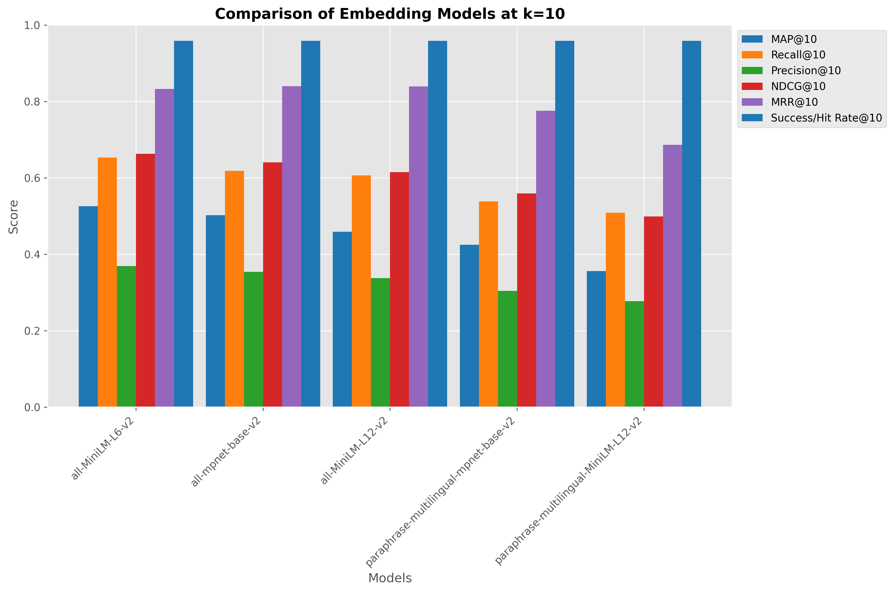
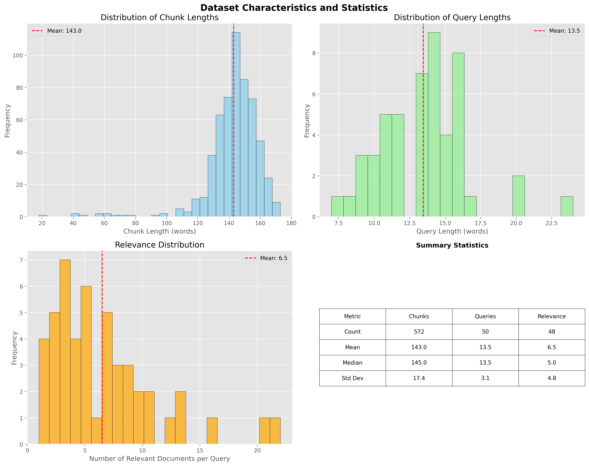
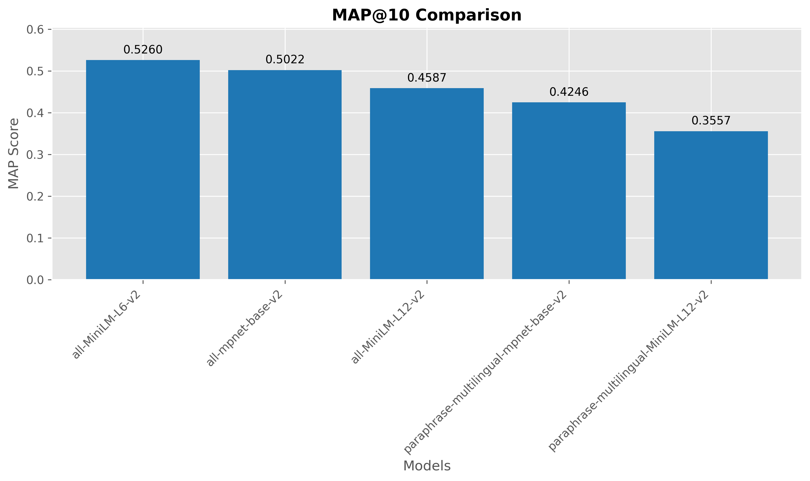
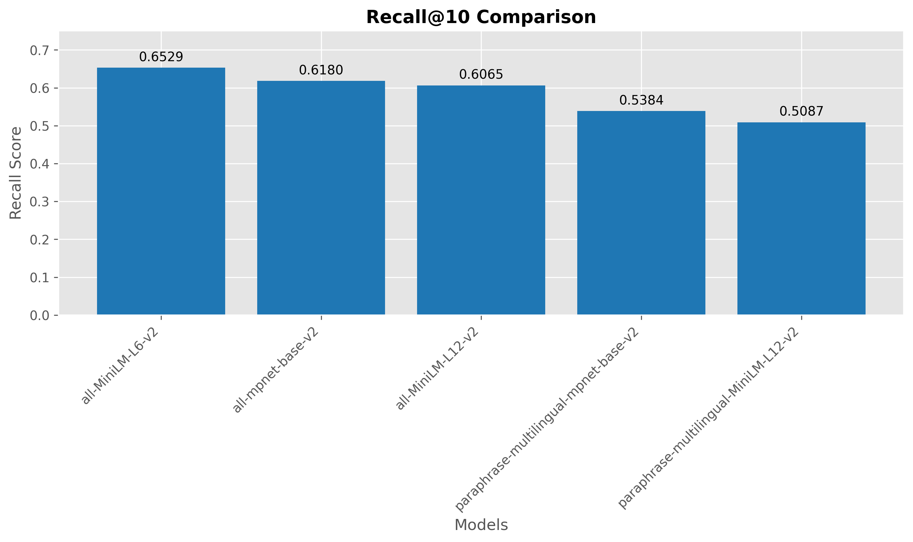
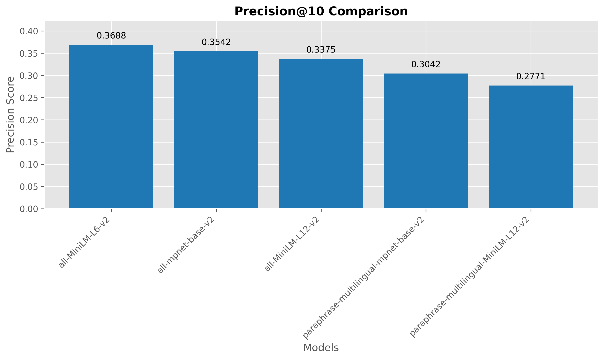
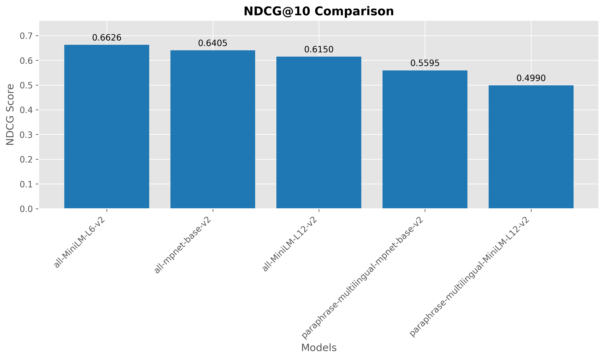
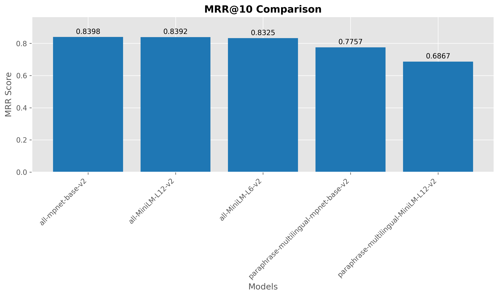
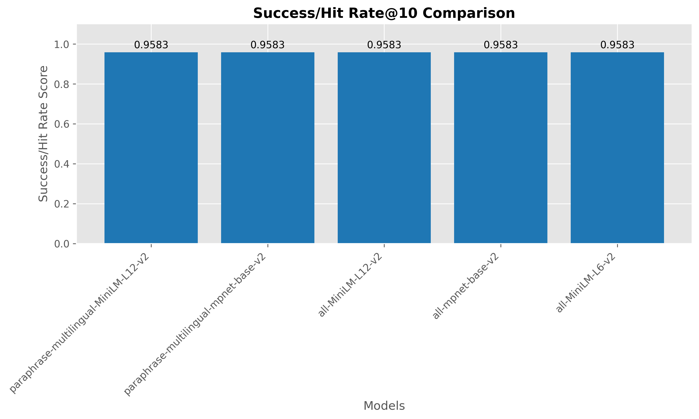
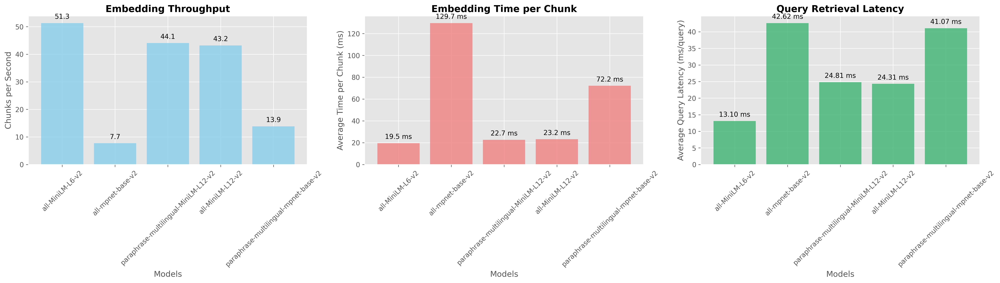

# RAG Retrieval Benchmark: Education_Eng_Rerun Dataset Evaluation

**Dataset:** Education_Eng_Rerun
**Generated:** 2026-07-23 17:51:55

## Abstract

This paper presents a systematic evaluation of embedding models on the education_eng_rerun dataset within Retrieval Augmented Generation (RAG) systems. We developed an automated pipeline that processes documents (PDFs), generates synthetic queries using large language models, and evaluates retrieval performance across multiple embedding models using standardized information retrieval metrics. Our framework provides researchers and practitioners with a reproducible methodology for selecting optimal embedding models for their specific document collections and use cases.

## Executive Summary

This report presents a comparative analysis of embedding models for retrieval augmented generation (RAG) on the education_eng_rerun dataset. The models were evaluated on their ability to retrieve relevant documents using ChromaDB as the vector database. The benchmark used **29 document(s) (PDFs)** that were processed into **572 chunks** and **50 queries** with **312 relevant document mappings**.

**Best performing model:** `sentence-transformers/all-MiniLM-L6-v2`
* MAP@10: **0.5260**
* Recall@10: **0.6529**
* Precision@10: **0.3688**
* NDCG@10: **0.6626**
* MRR@10: **0.8325**
* Success/Hit Rate@10: **0.9583**

## Methodology

### Automated Pipeline Overview

Our evaluation framework consists of five main stages:

1. **Document (PDF) Processing**: Document ingestion and chunking
2. **Corpus Generation**: Creation of standardized chunks
3. **Query Generation**: LLM-assisted query synthesis
4. **Relevance Assessment**: Automated qrels generation
5. **Embedding Evaluation**: Multi-model performance comparison

### Document Processing Pipeline

#### PDF Extraction and Chunking

- **Source documents (PDFs)**: 29 file(s) from `datasets\education_eng_rerun\pdfs` directory
- **Chunking strategy**: Recursive character text splitting
- **Chunk size**: 1000 characters
- **Chunk overlap**: 200 characters
- **Total chunks generated**: 572

The chunking process uses LangChain's `RecursiveCharacterTextSplitter` to maintain semantic coherence while ensuring manageable chunk sizes for embedding models.

#### Query Generation Process

- **LLM Model**: models/gemini-2.5-flash-lite
- **Number of queries generated**: 50
- **Generation strategy**: Seed-chunk → Query → Retrieval → Label
- **Candidate pool size**: 20 chunks per query

Queries were generated using the following systematic approach:
1. Random sampling of seed chunks from the corpus
2. LLM-based question generation targeting specific chunks
3. Retrieval-based candidate identification using ChromaDB
4. LLM-based relevance labeling for comprehensive qrels

## Education_Eng_Rerun Dataset Statistics

#### Corpus Characteristics

| Metric                       |   Value |
|:-----------------------------|--------:|
| Source Documents (PDFs)      |    29   |
| Total Chunks                 |   572   |
| Average Chunk Length (words) |   143   |
| Median Chunk Length (words)  |   145   |
| Min Chunk Length (words)     |    18   |
| Max Chunk Length (words)     |   173   |
| Standard Deviation           |    17.4 |

**Table: Corpus Characteristics Summary**

**Column Explanations:**
- **Source Documents (PDFs)**: Number of source documents (PDF files) processed
- **Total Chunks**: Number of text chunks created from documents (PDFs)
- **Average Chunk Length**: Mean number of words per chunk
- **Median Chunk Length**: Middle value of chunk lengths (resistant to outliers)
- **Min/Max Chunk Length**: Range of chunk sizes
- **Standard Deviation**: Variability in chunk lengths

**How to interpret:**
- **High variability** (large std dev) indicates inconsistent chunking
- **Very short chunks** may lose context, very long chunks may be noisy
- **Chunk count** affects retrieval efficiency and memory usage

#### Query Characteristics

| Metric                       |   Value |
|:-----------------------------|--------:|
| Total Queries                |    50   |
| Average Query Length (words) |    13.5 |
| Median Query Length (words)  |    13.5 |
| Min Query Length (words)     |     7   |
| Max Query Length (words)     |    24   |
| Standard Deviation           |     3.1 |

**Table: Query Characteristics Summary**

**Column Explanations:**
- **Total Queries**: Number of evaluation queries generated
- **Average Query Length**: Mean number of words per query
- **Median Query Length**: Middle value of query lengths
- **Min/Max Query Length**: Range of query lengths
- **Standard Deviation**: Variability in query lengths

**How to interpret:**
- **Query length** affects retrieval difficulty (longer = more specific)
- **High variability** indicates diverse query types
- **Query count** determines statistical power of evaluation

#### Relevance Distribution

| Metric                               | Value   |
|:-------------------------------------|:--------|
| Total Relevance Judgments            | 312     |
| Average Relevant Documents per Query | 6.5     |
| Median Relevant Documents per Query  | 5.0     |
| Min Relevant Documents               | 1       |
| Max Relevant Documents               | 22      |
| Coverage Ratio                       | 54.55%  |

**Table: Relevance Distribution Summary**

**Column Explanations:**
- **Total Relevance Judgments**: Total number of relevant document-query pairs
- **Average Relevant Documents per Query**: Mean number of relevant documents per query
- **Median Relevant Documents per Query**: Middle value of relevant documents per query
- **Min/Max Relevant Documents**: Range of relevant documents per query
- **Coverage Ratio**: Percentage of corpus that is relevant to queries

**How to interpret:**
- **High average relevant documents** = easier retrieval task
- **Low coverage ratio** = sparse relevance (harder evaluation)
- **High variability** indicates inconsistent query difficulty

## Experimental Setup

### Evaluation Framework

- **Vector Database**: ChromaDB
- **Evaluation Library**: SentenceTransformers InformationRetrievalEvaluator
- **Retrieval Depth (k)**: 10
- **Batch Size**: 32
- **Collection Reinitialization**: True

### Evaluated Models

| Model Name                                                  | Collection                  |   Dimensions | Type                 |
|:------------------------------------------------------------|:----------------------------|-------------:|:---------------------|
| sentence-transformers/all-MiniLM-L6-v2                      | education_eng_rerun_coll_v1 |          384 | Sentence Transformer |
| sentence-transformers/all-mpnet-base-v2                     | education_eng_rerun_coll_v2 |          768 | Sentence Transformer |
| sentence-transformers/paraphrase-multilingual-MiniLM-L12-v2 | education_eng_rerun_coll_v3 |          384 | Sentence Transformer |
| sentence-transformers/all-MiniLM-L12-v2                     | education_eng_rerun_coll_v4 |          384 | Sentence Transformer |
| sentence-transformers/paraphrase-multilingual-mpnet-base-v2 | education_eng_rerun_coll_v5 |          768 | Sentence Transformer |

**Table: Evaluated Embedding Models**

**Column Explanations:**
- **Model Name**: Full model identifier from Hugging Face or provider
- **Collection**: ChromaDB collection name for this model
- **Dimensions**: Embedding vector dimensionality
- **Type**: Model architecture or framework

**How to interpret:**
- **Higher dimensions** generally capture more semantic nuance
- **Different architectures** have different strengths/weaknesses
- **Collection names** ensure isolated evaluation per model

### Evaluation Metrics

| Metric      | Description                                                      | Measures                   |
|:------------|:-----------------------------------------------------------------|:---------------------------|
| MAP@k       | Mean Average Precision at rank k                                 | Ranking quality            |
| Recall@k    | Proportion of relevant documents in top k                        | Coverage                   |
| Precision@k | Proportion of relevant documents among retrieved                 | Accuracy                   |
| NDCG@k      | Normalized Discounted Cumulative Gain                            | Ranking with position bias |
| MRR@k       | Mean Reciprocal Rank                                             | First relevant position    |
| Success@k   | Fraction of queries with at least one relevant document in top k | Query-level success        |

**Table: Evaluation Metrics Overview**

**Metric Details:**
- **MAP@k**: Mean Average Precision - balances precision and recall across ranks
- **Recall@k**: Coverage - fraction of relevant documents retrieved in top k
- **Precision@k**: Accuracy - fraction of retrieved documents that are relevant
- **NDCG@k**: Position-aware ranking quality with logarithmic discounting
- **MRR@k**: First relevant position - emphasizes finding relevant documents early
- **Success@k**: Success@k / Hit Rate@k - fraction of queries with at least one relevant hit in top k

**When to use each metric:**
- **MAP**: Overall ranking quality for information retrieval
- **Recall**: Ensuring comprehensive coverage of relevant content
- **Precision**: Minimizing irrelevant results in recommendations
- **NDCG**: Search engine ranking with position bias
- **MRR**: Question-answering where first relevant result matters
- **Success**: Measuring query-level success rate when at least one relevant hit is enough

### Representative Query Examples

| Query ID                     | Query Text                                                                                                                       |   # Relevant Documents |
|:-----------------------------|:---------------------------------------------------------------------------------------------------------------------------------|-----------------------:|
| q1_for_English_chunk<br/>24  | What are the requirements for students to pass each level and advance in the ELS program?                                        |                      6 |
| q2_for_Barriers_chun<br/>k8  | What are the responsibilities of instructors regarding disabled students and coordination with the "TEDU Without Barriers" Unit? |                      3 |
| q3_for_PartTime_chun<br/>k6  | What are the procedures and requirements for part-time student employment at TED University?                                     |                      5 |
| q4_for_mobility_chun<br/>k24 | What constitutes a force majeure event in contractual agreements?                                                                |                      7 |
| q5_for_mobility_chun<br/>k2  | Erasmus+ program details for student mobility and application timeline.                                                          |                     22 |

**Table: Representative Query Examples**

**Column Explanations:**
- **Query ID**: Unique identifier for each query
- **Query Text**: The actual query text used for retrieval
- **# Relevant Documents**: Number of ground truth relevant documents

**How to interpret:**
- **Query diversity** shows the range of information needs tested
- **Relevant document count** indicates query specificity (fewer = more specific)
- **Query length** may correlate with retrieval difficulty

## Results

### Model Performance Comparison

**Table: Comprehensive Model Performance Results**

| Model                                 |   MAP@10 |   Recall@10 |   Precision@10 |   NDCG@10 |   MRR@10 |   Success@10 |
|:--------------------------------------|---------:|------------:|---------------:|----------:|---------:|-------------:|
| all-MiniLM-L6-v2                      |   0.526  |      0.6529 |         0.3688 |    0.6626 |   0.8325 |       0.9583 |
| all-mpnet-base-v2                     |   0.5022 |      0.618  |         0.3542 |    0.6405 |   0.8398 |       0.9583 |
| all-MiniLM-L12-v2                     |   0.4587 |      0.6065 |         0.3375 |    0.615  |   0.8392 |       0.9583 |
| paraphrase-multilingual-mpnet-base-v2 |   0.4246 |      0.5384 |         0.3042 |    0.5595 |   0.7757 |       0.9583 |
| paraphrase-multilingual-MiniLM-L12-v2 |   0.3557 |      0.5087 |         0.2771 |    0.499  |   0.6867 |       0.9583 |

**Table: Model Performance Results Explanation**

**Column Explanations:**
- **Model**: Embedding model name (shortened for readability)
- **MAP@10**: Mean Average Precision at rank 10
- **Recall@10**: Fraction of relevant documents retrieved in top 10
- **Precision@10**: Fraction of retrieved documents that are relevant
- **NDCG@10**: Normalized Discounted Cumulative Gain at rank 10
- **MRR@10**: Mean Reciprocal Rank at rank 10
- **Success@10**: Success@10 / Hit Rate@10: fraction of queries with >=1 relevant retrieved

**How to interpret the results:**
- **Higher scores** = better retrieval performance
- **MAP**: MAP balances ranking quality and coverage
- **Recall**: Recall shows how comprehensive the retrieval is
- **Precision**: Precision shows how accurate the retrieval is
- **NDCG**: NDCG rewards relevant documents appearing early
- **MRR**: MRR emphasizes finding the first relevant result
- **Success**: Success/Hit Rate captures whether queries get at least one relevant hit

### Performance Analysis

The evaluation reveals observable performance differences across embedding models. **sentence-transformers/all-MiniLM-L6-v2** achieved the highest MAP@10 score of 0.5260, while **sentence-transformers/paraphrase-multilingual-MiniLM-L12-v2** scored 0.3557, representing a **47.9% relative improvement**.

**MAP-Recall Correlation**: 0.966 (indicates how well ranking quality correlates with coverage)

### Visual Analysis

#### 6.3.1 Overall Performance Comparison



**Figure: Comprehensive Model Performance Comparison**

This bar chart compares all embedding models across all evaluation metrics at k=10. Each model has a group of bars showing its performance on different metrics.

**How to interpret:**
- **Taller bars** indicate better performance on that metric
- **Consistent height across metrics** shows well-rounded models
- **Spiky patterns** reveal specialized models (good at some metrics, poor at others)
- **Model grouping** allows direct comparison between models

**Why it matters:** Identifies models with balanced capabilities vs. specialized models, helping you choose based on your specific requirements.

#### 6.3.2 Dataset Characteristics



**Figure: Dataset Characteristics and Distributions**

This figure contains four subplots showing the statistical properties of your evaluation dataset:

**Top-left: Chunk Length Distribution**
- Shows how chunk sizes vary across the corpus
- **Normal distribution** indicates consistent chunking
- **Skewed distribution** suggests chunking strategy issues

**Top-right: Query Length Distribution**
- Shows the diversity of query lengths in your evaluation set
- **Wide range** indicates varied information needs
- **Narrow range** suggests similar query complexity

**Bottom-left: Relevance Distribution**
- Shows how many relevant documents exist per query
- **Right-skewed** = most queries have few relevant documents (harder task)
- **Left-skewed** = most queries have many relevant documents (easier task)

**Bottom-right: Summary Statistics Table**
- Key metrics for chunk lengths, query lengths, and relevance
- Helps assess dataset quality and evaluation difficulty

**Why it matters:** Understanding your dataset characteristics helps interpret model performance results and identify potential evaluation biases.

#### 6.3.3 Individual Metric Analysis

The following charts provide detailed performance breakdowns for each evaluation metric. Each chart focuses on a single metric to enable precise model comparisons.

##### MAP@10 Performance



**MAP@k (Mean Average Precision)**: Measures ranking quality by averaging precision at each relevant document position. Rewards models that rank relevant documents highly.

**Interpretation**: Higher values indicate better overall ranking performance. Useful for general information retrieval tasks.

##### Recall@10 Performance



**Recall@k**: Measures the fraction of relevant documents that are successfully retrieved in the top k results. Focuses on coverage of relevant content.

**Interpretation**: Higher values indicate more comprehensive retrieval. Important when missing relevant information is costly.

##### Precision@10 Performance



**Precision@k**: Measures the fraction of retrieved documents that are actually relevant. Focuses on accuracy of the retrieved results.

**Interpretation**: Higher values indicate fewer irrelevant results. Important when irrelevant information reduces user satisfaction.

##### NDCG@10 Performance



**NDCG@k (Normalized Discounted Cumulative Gain)**: Measures ranking quality with position-based discounting. Relevant documents are more valuable when ranked higher.

**Interpretation**: Higher values indicate better ranking with proper position weighting. Standard metric for search engine evaluation.

##### MRR@10 Performance



**MRR@k (Mean Reciprocal Rank)**: Measures how early the first relevant document appears in the ranked results. Emphasizes finding relevant information quickly.

**Interpretation**: Higher values indicate faster discovery of relevant content. Critical for question-answering and single-answer scenarios.

##### Success/Hit Rate@10 Performance



**Success@k / Hit Rate@k**: Measures the fraction of queries where at least one relevant document appears in top-k results.

**Interpretation**: Higher values indicate more queries are successfully served. Useful when any relevant hit is sufficient for a good user experience.

### Pairwise Difference Analysis (Descriptive)

This section helps determine whether observed performance differences between models are meaningful in practice. These tables are descriptive and use simple thresholds; they are not formal hypothesis tests.

**Understanding the Results:**
- **Difference > 0.05**: Potentially meaningful improvement for real applications
- **Difference > 0.10**: Large practical performance gap
- **Difference < 0.02**: Likely negligible for most use cases
- **Values marked with *** indicate differences above the 0.05 heuristic threshold

**Important Caveats:**
- These are absolute differences, not p-values
- Statistical significance requires query-level paired testing (e.g., bootstrap/permutation)
- Consider practical importance alongside statistical significance

#### MAP@10 Pairwise Differences

| Model                                 | all-MiniLM-L6-v2   | all-mpnet-base-v2   | all-MiniLM-L12-v2   | paraphrase-multilingual-mpnet-base-v2   | paraphrase-multilingual-MiniLM-L12-v2   |
|:--------------------------------------|:-------------------|:--------------------|:--------------------|:----------------------------------------|:----------------------------------------|
| all-MiniLM-L6-v2                      | -                  | 0.0238              | 0.0673*             | 0.1014*                                 | 0.1703*                                 |
| all-mpnet-base-v2                     | 0.0238             | -                   | 0.0435              | 0.0776*                                 | 0.1465*                                 |
| all-MiniLM-L12-v2                     | 0.0673*            | 0.0435              | -                   | 0.0341                                  | 0.1031*                                 |
| paraphrase-multilingual-mpnet-base-v2 | 0.1014*            | 0.0776*             | 0.0341              | -                                       | 0.0689*                                 |
| paraphrase-multilingual-MiniLM-L12-v2 | 0.1703*            | 0.1465*             | 0.1031*             | 0.0689*                                 | -                                       |

*Note: Values marked with * indicate differences above the 0.05 heuristic threshold.*

#### Recall@10 Pairwise Differences

| Model                                 | all-MiniLM-L6-v2   | all-mpnet-base-v2   | all-MiniLM-L12-v2   | paraphrase-multilingual-mpnet-base-v2   | paraphrase-multilingual-MiniLM-L12-v2   |
|:--------------------------------------|:-------------------|:--------------------|:--------------------|:----------------------------------------|:----------------------------------------|
| all-MiniLM-L6-v2                      | -                  | 0.0349              | 0.0465              | 0.1146*                                 | 0.1442*                                 |
| all-mpnet-base-v2                     | 0.0349             | -                   | 0.0116              | 0.0797*                                 | 0.1093*                                 |
| all-MiniLM-L12-v2                     | 0.0465             | 0.0116              | -                   | 0.0681*                                 | 0.0978*                                 |
| paraphrase-multilingual-mpnet-base-v2 | 0.1146*            | 0.0797*             | 0.0681*             | -                                       | 0.0297                                  |
| paraphrase-multilingual-MiniLM-L12-v2 | 0.1442*            | 0.1093*             | 0.0978*             | 0.0297                                  | -                                       |

*Note: Values marked with * indicate differences above the 0.05 heuristic threshold.*

#### Precision@10 Pairwise Differences

| Model                                 | all-MiniLM-L6-v2   | all-mpnet-base-v2   | all-MiniLM-L12-v2   | paraphrase-multilingual-mpnet-base-v2   | paraphrase-multilingual-MiniLM-L12-v2   |
|:--------------------------------------|:-------------------|:--------------------|:--------------------|:----------------------------------------|:----------------------------------------|
| all-MiniLM-L6-v2                      | -                  | 0.0146              | 0.0312              | 0.0646*                                 | 0.0917*                                 |
| all-mpnet-base-v2                     | 0.0146             | -                   | 0.0167              | 0.0500                                  | 0.0771*                                 |
| all-MiniLM-L12-v2                     | 0.0312             | 0.0167              | -                   | 0.0333                                  | 0.0604*                                 |
| paraphrase-multilingual-mpnet-base-v2 | 0.0646*            | 0.0500              | 0.0333              | -                                       | 0.0271                                  |
| paraphrase-multilingual-MiniLM-L12-v2 | 0.0917*            | 0.0771*             | 0.0604*             | 0.0271                                  | -                                       |

*Note: Values marked with * indicate differences above the 0.05 heuristic threshold.*

#### NDCG@10 Pairwise Differences

| Model                                 | all-MiniLM-L6-v2   | all-mpnet-base-v2   | all-MiniLM-L12-v2   | paraphrase-multilingual-mpnet-base-v2   | paraphrase-multilingual-MiniLM-L12-v2   |
|:--------------------------------------|:-------------------|:--------------------|:--------------------|:----------------------------------------|:----------------------------------------|
| all-MiniLM-L6-v2                      | -                  | 0.0221              | 0.0476              | 0.1031*                                 | 0.1636*                                 |
| all-mpnet-base-v2                     | 0.0221             | -                   | 0.0255              | 0.0810*                                 | 0.1415*                                 |
| all-MiniLM-L12-v2                     | 0.0476             | 0.0255              | -                   | 0.0555*                                 | 0.1160*                                 |
| paraphrase-multilingual-mpnet-base-v2 | 0.1031*            | 0.0810*             | 0.0555*             | -                                       | 0.0605*                                 |
| paraphrase-multilingual-MiniLM-L12-v2 | 0.1636*            | 0.1415*             | 0.1160*             | 0.0605*                                 | -                                       |

*Note: Values marked with * indicate differences above the 0.05 heuristic threshold.*

#### MRR@10 Pairwise Differences

| Model                                 | all-MiniLM-L6-v2   | all-mpnet-base-v2   | all-MiniLM-L12-v2   | paraphrase-multilingual-mpnet-base-v2   | paraphrase-multilingual-MiniLM-L12-v2   |
|:--------------------------------------|:-------------------|:--------------------|:--------------------|:----------------------------------------|:----------------------------------------|
| all-MiniLM-L6-v2                      | -                  | 0.0073              | 0.0068              | 0.0568*                                 | 0.1458*                                 |
| all-mpnet-base-v2                     | 0.0073             | -                   | 0.0005              | 0.0641*                                 | 0.1531*                                 |
| all-MiniLM-L12-v2                     | 0.0068             | 0.0005              | -                   | 0.0635*                                 | 0.1526*                                 |
| paraphrase-multilingual-mpnet-base-v2 | 0.0568*            | 0.0641*             | 0.0635*             | -                                       | 0.0890*                                 |
| paraphrase-multilingual-MiniLM-L12-v2 | 0.1458*            | 0.1531*             | 0.1526*             | 0.0890*                                 | -                                       |

*Note: Values marked with * indicate differences above the 0.05 heuristic threshold.*

#### Success/Hit Rate@10 Pairwise Differences

| Model                                 | all-MiniLM-L6-v2   | all-mpnet-base-v2   | all-MiniLM-L12-v2   | paraphrase-multilingual-mpnet-base-v2   | paraphrase-multilingual-MiniLM-L12-v2   |
|:--------------------------------------|:-------------------|:--------------------|:--------------------|:----------------------------------------|:----------------------------------------|
| all-MiniLM-L6-v2                      | -                  | 0.0000              | 0.0000              | 0.0000                                  | 0.0000                                  |
| all-mpnet-base-v2                     | 0.0000             | -                   | 0.0000              | 0.0000                                  | 0.0000                                  |
| all-MiniLM-L12-v2                     | 0.0000             | 0.0000              | -                   | 0.0000                                  | 0.0000                                  |
| paraphrase-multilingual-mpnet-base-v2 | 0.0000             | 0.0000              | 0.0000              | -                                       | 0.0000                                  |
| paraphrase-multilingual-MiniLM-L12-v2 | 0.0000             | 0.0000              | 0.0000              | 0.0000                                  | -                                       |

*Note: Values marked with * indicate differences above the 0.05 heuristic threshold.*

## Compute And Retrieval Performance Metrics

This section analyzes the computational efficiency of different embedding models during corpus initialization and retrieval. Understanding speed and latency is crucial for production deployment decisions.

**Why timing metrics matter:**
- **Initial setup time**: How long to embed your entire corpus
- **Update frequency**: How often you can refresh embeddings
- **Query responsiveness**: How fast retrieval returns results at runtime
- **Scalability**: Performance with larger document collections
- **Cost**: Computational resources required for deployment

#### Embedding Speed And Query Latency Comparison

| Model                                                       |   Embedding Time (s) |   Chunks/Second |   Avg Time/Chunk (ms) |   Avg Query Latency (ms/query) |   Queries Timed |
|:------------------------------------------------------------|---------------------:|----------------:|----------------------:|-------------------------------:|----------------:|
| sentence-transformers/all-MiniLM-L6-v2                      |                11.15 |           51.31 |                 19.49 |                          13.1  |              48 |
| sentence-transformers/all-MiniLM-L12-v2                     |                13.24 |           43.19 |                 23.15 |                          24.31 |              48 |
| sentence-transformers/paraphrase-multilingual-MiniLM-L12-v2 |                12.97 |           44.09 |                 22.68 |                          24.81 |              48 |
| sentence-transformers/paraphrase-multilingual-mpnet-base-v2 |                41.27 |           13.86 |                 72.16 |                          41.07 |              48 |
| sentence-transformers/all-mpnet-base-v2                     |                74.17 |            7.71 |                129.66 |                          42.62 |              48 |

**Table: Compute And Retrieval Performance Metrics**

**Column Explanations:**
- **Model**: Embedding model name
- **Embedding Time (s)**: Total time to embed all chunks
- **Chunks/Second**: Processing throughput (higher = faster)
- **Avg Time/Chunk (ms)**: Average time per chunk
- **Avg Query Latency (ms/query)**: Average DB retrieval time per query (lower = faster)
- **Queries Timed**: Number of queries included in retrieval latency measurement

**How to interpret:**
- **Higher Chunks/Second** = more efficient processing
- **Lower Avg Time/Chunk** = faster embedding of individual chunks
- **Lower Avg Query Latency** = faster retrieval responsiveness at runtime
- **Trade-offs**: Speed often correlates with model size/complexity
- **Production considerations**: Balance speed with retrieval quality

#### Performance Insights

- **Fastest embedding model**: `sentence-transformers/all-MiniLM-L6-v2` at 51.31 chunks/second
- **Slowest embedding model**: `sentence-transformers/all-mpnet-base-v2` at 7.71 chunks/second
- **Embedding performance ratio**: 6.65x (fastest vs slowest)
- **Lowest retrieval latency**: `sentence-transformers/all-MiniLM-L6-v2` at 13.10 ms/query
- **Highest retrieval latency**: `sentence-transformers/all-mpnet-base-v2` at 42.62 ms/query
- **Retrieval latency spread**: 3.25x (highest vs lowest)


*Figure: Embedding speed and query retrieval latency comparison across models.*

## Technical Implementation

### Pipeline Architecture

The benchmark pipeline implements a modular architecture with the following components:

- **Document Processing Module**: PDF extraction and chunking using PyMuPDF and LangChain
- **LLM Integration**: Gemini API for query generation and relevance assessment
- **Vector Database**: ChromaDB with native embedding functions
- **Evaluation Engine**: SentenceTransformers evaluation framework
- **Reporting System**: Automated report generation with visualizations

### Reproducibility

All experiments can be reproduced using the following commands:

```bash
# 1. Process PDFs into chunks
python rag_benchmark.py --dataset education_eng_rerun --prepare-corpus

# 2. Generate queries
python rag_benchmark.py --dataset education_eng_rerun --generate-queries

# 3. Generate relevance judgments
python rag_benchmark.py --dataset education_eng_rerun --generate-qrels

# 4. Run complete benchmark
python rag_benchmark.py --dataset education_eng_rerun --all
```

### Embedding Model Specifications

#### sentence-transformers/all-MiniLM-L6-v2

- **Collection identifier**: `education_eng_rerun_coll_v1`
- **Embedding dimension**: 384
- **Maximum sequence length**: 256
- **Model architecture**: Transformer-based sentence encoder

#### sentence-transformers/all-mpnet-base-v2

- **Collection identifier**: `education_eng_rerun_coll_v2`
- **Embedding dimension**: 768
- **Maximum sequence length**: 384
- **Model architecture**: Transformer-based sentence encoder

#### sentence-transformers/paraphrase-multilingual-MiniLM-L12-v2

- **Collection identifier**: `education_eng_rerun_coll_v3`
- **Embedding dimension**: 384
- **Maximum sequence length**: 128
- **Model architecture**: Transformer-based sentence encoder

#### sentence-transformers/all-MiniLM-L12-v2

- **Collection identifier**: `education_eng_rerun_coll_v4`
- **Embedding dimension**: 384
- **Maximum sequence length**: 128
- **Model architecture**: Transformer-based sentence encoder

#### sentence-transformers/paraphrase-multilingual-mpnet-base-v2

- **Collection identifier**: `education_eng_rerun_coll_v5`
- **Embedding dimension**: 768
- **Maximum sequence length**: 128
- **Model architecture**: Transformer-based sentence encoder

## Discussion

### Key Findings

1. **Model Performance Hierarchy**: sentence-transformers/all-MiniLM-L6-v2 emerged as the top performer, achieving superior results across multiple evaluation metrics.

2. **Performance Gaps**: The performance difference between the best and second-best models (0.0238 MAP@10) is moderate, suggesting measurable but limited separation between top candidates.

3. **Automated Evaluation Viability**: The LLM-assisted query and relevance generation process demonstrates the feasibility of automated benchmark creation for domain-specific document collections.

### Limitations and Future Work

- **Single-domain evaluation**: Current results are specific to the evaluated document collection
- **LLM bias**: Query generation and relevance judgments may reflect biases of the generative model
- **Limited query diversity**: Future work should explore multi-turn queries and complex information needs
- **Scalability**: Evaluation should be extended to larger document collections and more diverse domains

## Conclusion

This study presents a comprehensive framework for evaluating embedding models in RAG systems. Our automated pipeline successfully generated meaningful evaluation datasets and provided structured comparative analysis of model performance. The results demonstrate that **sentence-transformers/all-MiniLM-L6-v2** provides optimal retrieval performance for the evaluated document collection, with a MAP@10 score of 0.5260. The substantial performance variations across models underscore the importance of systematic evaluation in embedding model selection for production RAG systems.

The open-source nature of our evaluation framework enables researchers and practitioners to adapt the methodology for their specific domains and requirements, contributing to more systematic and reproducible evaluation practices in the RAG community.

---

*This report was automatically generated by the RAG Retrieval Benchmark Pipeline at 2026-07-23_17-51-50.*
*Source code and evaluation data available at the project repository.*
