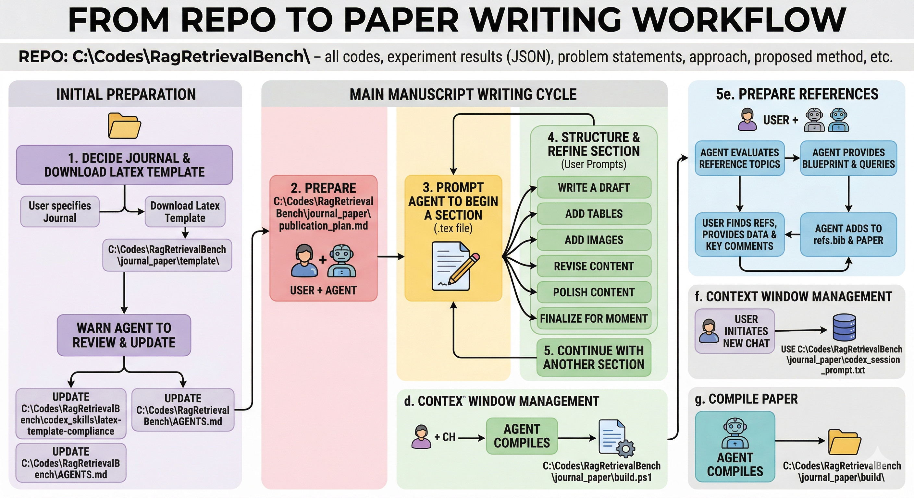

# How To Write This Paper With Codex

This file is the practical guide for a human working with Codex in VS Code.

## Full Workflow: From Solved Repo to Paper Writing

Working assumption:

- The work starts from one repository that already contains the solved coding problem, implementation, experiment outputs in JSON format, and the problem/approach/proposed-method context in repo files.

Start-here workflow:

1. Select the target journal/paper and place the LaTeX template under `journal_paper/template/`.
2. Ask the agent to review the template and align `AGENTS.md` and `codex_skills/latex-template-compliance/SKILL.md` if template constraints require updates.
3. Prepare `journal_paper/publication_plan.md` with the agent as the canonical planning baseline.
4. Start one section cycle in a target `.tex` file: draft writing, table work, image placeholder/insertion, revision, polish, and temporary finalize.
5. Repeat the same section cycle for the next sections until all major manuscript sections are covered.
6. Run the dedicated related-work cycle: agent prepares topic blueprint and search queries, user collects papers/metadata/key comments, agent integrates evidence into `journal_paper/refs.bib` and `journal_paper/related.tex`, then performs final positioning polish.
7. If context window gets crowded, start a new chat and reboot workflow with `journal_paper/codex_session_prompt.txt`.
8. Validate and compile using `journal_paper/build.ps1`; generated artifacts are written under `journal_paper/build/<timestamp>/`.



Authority contract:

- Policy rules come from `AGENTS.md`, template-compliance checks come from `codex_skills/latex-template-compliance/SKILL.md`, operational prompting comes from this `journal_paper/how_to_write_paper.md`, and planning state comes from `journal_paper/publication_plan.md`.

## 1) What to edit

Edit only these source files:

- `journal_paper/manuscript.tex`
- `journal_paper/*.tex`
- `journal_paper/refs.bib`

Do not edit generated files inside `journal_paper/build/...`.

## 2) What each control file does

- `AGENTS.md`
  - repo-wide rules automatically available to Codex in this repository
  - use this as the non-negotiable policy layer
- `journal_paper/codex_session_prompt.txt`
  - short session bootstrap text you can paste into a new Codex chat
  - use this to force the session into the paper workflow immediately
- `journal_paper/publication_plan.md`
  - canonical planning source for paper-writing cycles
  - use this for claim boundaries, snapshot constraints, and step-1 planning
- `codex_skills/latex-template-compliance/SKILL.md`
  - detailed CAS/LaTeX workflow guidance
  - use this when the task is about tables, figures, labels, citations, layout, or template compliance

## 3) How the human should use them

For a normal paper-writing session in VS Code:

1. Start a new Codex chat.
2. Tell Codex to read:
   - `AGENTS.md`
   - `journal_paper/codex_session_prompt.txt`
   - `journal_paper/publication_plan.md`
3. If the task is formatting-heavy or template-sensitive, also tell Codex to use:
   - `codex_skills/latex-template-compliance/SKILL.md`
4. Then give the actual section-editing task.

Use the skill explicitly when:

- editing tables or figures
- moving content between sections
- fixing labels/cross-references
- checking template compliance
- resolving LaTeX build/layout issues

## 4) Recommended session starter prompt

At the start of a new chat, paste:

```text
Use this repo workflow exactly.
Read and follow AGENTS.md and journal_paper/codex_session_prompt.txt.
Use journal_paper/publication_plan.md as the canonical planning baseline.
If the task is template-sensitive, also use codex_skills/latex-template-compliance/SKILL.md.
Edit only journal_paper/manuscript.tex, journal_paper/*.tex, and journal_paper/refs.bib.
Follow Elsevier CAS template conventions.
Run powershell -NoProfile -ExecutionPolicy Bypass -File journal_paper/build.ps1 -CompilePdf before declaring success.
```

## 5) How to use `build.ps1`

`journal_paper/build.ps1` is the required validation gate.

Use:

```powershell
powershell -NoProfile -ExecutionPolicy Bypass -File journal_paper/build.ps1
```

This checks:

- repo/template lint rules
- captions/labels
- path and structural rules
- other manuscript gate checks

Use:

```powershell
powershell -NoProfile -ExecutionPolicy Bypass -File journal_paper/build.ps1 -CompilePdf
```

This does the full validation path:

- lint/template checks
- wrapper generation
- XeLaTeX/BibTeX/PDF build

For real manuscript editing, prefer `-CompilePdf`, because some failures only appear during actual LaTeX compilation.

## 6) How to interpret build results

- If lint fails:
  - fix manuscript-rule violations first
- If PDF compile fails but lint passes:
  - inspect LaTeX/layout issues such as floats, tables, references, or environment problems
- If MiKTeX or environment setup fails:
  - treat that as a machine issue, not a manuscript-logic issue

Always ask Codex to report:

- files changed
- summary of fixes
- latest build folder
- PDF path if compiled
- remaining warnings, if any

## 7) Practical advice for section work

- Tell Codex which section owns the content before asking for edits.
- Ask Codex to keep prose, tables, and figures aligned.
- Ask Codex to reference tables/figures in the text.
- Ask Codex to regenerate the PDF after each substantial section change.
- If a small table causes LaTeX trouble, ask Codex to prefer `table` over `longtable` unless multi-page behavior is required.
- If a figure does not exist yet, ask Codex to:
  - insert a CAS-compliant figure placeholder with `\caption{...}` and `\label{...}`
  - add a short design prompt in a nearby LaTeX comment
  - write a reusable image-generation prompt you can paste into Banana 2 or another image model

Recommended wording:

```text
If the figure is not available yet, add a placeholder figure in the section with a proper caption and label, and include a short nearby prompt/comment so I can later generate the figure with Banana 2.
```

## 8) Related Work: 5-Round Related-Work Development

### Summary

- Use a **two-batch, 5-round workflow** to build a strong `related.tex` with controlled evidence growth and explicit gap closure.
- Final target: **12-16 peer-reviewed papers** total.
- Core principle: the agent writes only from manuscript context + your provided paper metadata/abstracts; no invented facts.

### Implementation Changes (Round-by-Round Prompt Set)

1. **Round 1: Topic Mapping and Search Blueprint (Agent, no file edits)**

```text
Use this repo workflow exactly.
Read AGENTS.md, journal_paper/codex_session_prompt.txt, and codex_skills/latex-template-compliance/SKILL.md.

Round scope:
- Read-only on manuscript files.
- Write output only to: journal_paper/literature_blueprint.md
- Do not edit any other file in this round.

Task:
Read manuscript context from:
- journal_paper/intro.tex
- journal_paper/related.tex
- journal_paper/method.tex
- journal_paper/experiments.tex
- journal_paper/results.tex
- journal_paper/conclusion.tex

Then create/update journal_paper/literature_blueprint.md with:

1) 3-4 thematic related-work clusters relevant to this paper.
2) For each cluster:
- why it matters for this paper’s claims
- 5-8 precise search queries
- inclusion criteria
- exclusion criteria
- target paper count for batch-1 vs batch-2
3) Claim-coverage map linking each cluster to manuscript claims.
4) A no-overlap guide: what stays in Related Work vs Method/Experiments/Results.

Constraints:
- no web search
- no fabricated papers or metadata
- use only evidence from manuscript context
- save the full blueprint in journal_paper/literature_blueprint.md

```

2. **Round 2: User Literature Collection Batch-1 (User action using template)**

```text
Create/refresh journal_paper/literature_round1.md as a strict intake template for batch-1 papers.

Template fields per paper:
- paper_id
- title
- authors
- year
- venue
- publication_type (journal/conference/workshop/preprint)
- doi_or_url
- abstract
- why_relevant_to_this_paper = optional
- optional: dataset_context, retrieval_setting, embedding_family, evaluation_metrics, reported_limitations
- confidence_note (mark uncertain metadata)

Also include:
- top-of-file checklist for complete entries
- one placeholder example block (dummy values only)

Do not edit related.tex or refs.bib in this round.
```

User fills `literature_round1.md` with **7-10 papers**.

3. **Round 3: Batch-1 Integration + Gap Analysis (Agent edits related.tex + refs.bib)**

```text
Use this repo workflow exactly.
Read and follow AGENTS.md, journal_paper/codex_session_prompt.txt, and codex_skills/latex-template-compliance/SKILL.md.
Focus only on:
- journal_paper/related.tex
- journal_paper/refs.bib
Input:
- journal_paper/literature_round1.md

Task:
1) Add BibTeX entries for all valid batch-1 papers.
2) Integrate batch-1 papers into related.tex using thematic grouping.
3) Add comparative writing (not isolated paper summaries).
4) Produce a gap memo at the end of your response:
- missing themes
- weak claim coverage
- recommended batch-2 paper types and count (5-7 papers)
5) If critical metadata is missing (authors, year, or title), do not add the BibTeX entry; list it under blocked/unresolved metadata.

Anti-hallucination rules:
- Use only metadata/claims from literature_round1.md.
- Do not invent missing metadata or study findings.
- For non-critical missing fields, use minimal valid BibTeX and report the omission.
- No external citations beyond provided papers.
- Every citation key used in related.tex must resolve in refs.bib.

Run:
powershell -NoProfile -ExecutionPolicy Bypass -File journal_paper/build.ps1 -CompilePdf

Report:
- added citation keys
- blocked/unresolved metadata list
- build folder + PDF path

```

4. **Round 4: User Literature Collection Batch-2 (Targeted closure)**

```text
Based on the Round-3 gap memo, create/update journal_paper/literature_blueprint_round2.md template with same schema as journal_paper/literature_blueprint.md round1.
Include a “required gap” tag per paper (e.g., reproducibility gap, local-corpus gap, multilingual gap, evaluation-design gap).
Do not edit related.tex or refs.bib in this round.
```

User fills `literature_round2.md` with **5-7 targeted papers**.

5. **Round 5: Final Integration, Positioning, and Publication-Ready Polish (Agent)**

```text
Use this repo workflow exactly.
Read and follow:
- AGENTS.md
- journal_paper/codex_session_prompt.txt
- codex_skills/latex-template-compliance/SKILL.md

Edit scope (strict):
- journal_paper/related.tex
- journal_paper/refs.bib

Read-only inputs:
- journal_paper/literature_round1.md
- journal_paper/literature_round2.md
- journal_paper/intro.tex
- journal_paper/method.tex
- journal_paper/experiments.tex
- journal_paper/results.tex
- journal_paper/conclusion.tex

Objective:
Deliver a publication-ready Related Work section by reconciling all claims with the provided literature abstracts/metadata and aligning positioning with this paper’s actual claims and section boundaries.

Tasks:
1) Bibliography reconciliation (final pass)
- Add any missing valid BibTeX entries from literature_round1.md and literature_round2.md.
- Deduplicate/merge overlapping entries and keep citation keys stable where already used.
- If critical metadata is missing (authors, year, or title), do not add the entry; list it under blocked/unresolved metadata.
- Remove/replace placeholder fields (e.g., TBD, Unknown) in touched entries.

2) Claim–evidence proofreading and correction
- Audit each substantive claim in related.tex against the provided abstracts/metadata only.
- If a claim is overstated, unsupported, or ambiguous, rewrite it conservatively or remove it.
- Keep comparative writing (not isolated paper summaries): coverage, limitations, and relevance to this paper’s claims.
- No “SOTA” or superiority statements unless explicitly evidenced in provided text.

3) Positioning and scope discipline
- Ensure related.tex clearly states:
  - what prior work covers,
  - what remains unresolved,
  - how this paper differs and why its contributions are valid.
- Keep strict boundaries: do not move setup/result details from Method/Experiments/Results into Related Work.
- Keep terminology consistent with repo guidance (reader-facing “paper”, “practitioner”).

4) Citation integrity and style checks
- Every citation key used in related.tex must exist in refs.bib.
- Do not cite papers outside literature_round1.md and literature_round2.md in this pass.
- Ensure prose is journal-grade, concise, non-repetitive, and thematically grouped.

Anti-hallucination rules:
- Use only claims supported by literature_round1.md / literature_round2.md abstracts and metadata.
- Do not invent venue/year/DOI/method details.
- Do not infer quantitative outcomes not present in provided text.
- When evidence is weak, explicitly hedge instead of asserting.

Run:
powershell -NoProfile -ExecutionPolicy Bypass -File journal_paper/build.ps1 -CompilePdf

Report:
- files changed
- added/updated citation keys
- blocked/unresolved metadata list
- claim adjustments made due to insufficient evidence (softened/removed)
- final thematic groups used
- remaining evidence limitations
- latest build folder + PDF path
```

## 9) Copy-Paste Prompt Library

Use these as ready-made prompts in VS Code instead of rewriting the same instructions each time.

### A. Start a new manuscript-editing session

```text
We will work on section journal_paper/<section>.tex 
Use this repo workflow exactly.
Read and follow AGENTS.md and journal_paper/codex_session_prompt.txt.
Use codex_skills/latex-template-compliance/SKILL.md if the task is template-sensitive.
Edit only journal_paper/manuscript.tex, journal_paper/*.tex, and journal_paper/refs.bib.
Follow Elsevier CAS template conventions.
Always run powershell -NoProfile -ExecutionPolicy Bypass -File journal_paper/build.ps1 -CompilePdf before declaring success.
```

### B. Rewrite one section in journal style

```text
Focus on journal_paper/<section>.tex only.
Rewrite this section in scientific journal style using the facts already available in the repo and generated reports.
Keep the section within its proper manuscript scope and do not duplicate content that belongs in other sections.
Keep prose, tables, and figures aligned.
Reference tables and figures in the text where appropriate. 
For the figures write a placeholder and propose a short prompt to be used to generate gigures later. 
Always regenerate the PDF before declaring success.
```

### B2. Full polish pass for one section wording

```text
Do a full polish pass on journal_paper/<section>.tex to make it read like a finished journal section:
- tighten the narrative arc
- strengthen scholarly framing
- clarify contribution framing
- improve transitions into the rest of the paper

Keep the section within its proper manuscript scope and do not duplicate content that belongs in other sections.
Do not introduce new claims that are unsupported by existing repo facts, generated reports, or current manuscript evidence.
Preserve labels/citations unless a change is necessary for correctness.
After all edits summarize what you have done along with the reasons.
Regenerate the PDF before declaring success.
```

### C. Keep section boundaries strict

```text
Be careful about section ownership.
Keep method.tex focused on the proposed pipeline and workflow.
Keep experiments.tex focused on the manuscript-specific setup, datasets, provenance, model roster, and limitations.
Keep results.tex focused on metrics, evidence, findings, and tradeoff interpretation.
Do not let Method absorb results discussion.
```

### D. Add or revise a figure placeholder

```text
Add a CAS-compliant figure placeholder in the target section with \caption{...} and \label{...}.
Include a short nearby LaTeX comment that can later be used to generate the image with Banana 2.
Also write a reusable Banana 2 prompt for the figure.
Keep the figure path flat inside journal_paper/.
```

### E. Review an image and replace a placeholder

```text
Check whether this image is appropriate for the intended figure in the section. Also ensure that the text recerencing this image is in line with the figure.
If it is acceptable, replace the placeholder in the relevant .tex file with the real image.
Keep the template figure structure correct and regenerate the PDF.
If the image is only partially acceptable, say what is still weak but insert it if it is usable.
```

### F. Align prose with a figure

```text
Considering the figure, revise the surrounding subsection text if necessary so the prose follows the actual workflow shown in the figure.
Do not change the section scope.
Keep the writing in scientific journal style.
Regenerate the PDF after the revision.
```

### G. Align tables with section text

```text
In this section, compare the table captions, headings, and row content with the surrounding prose.
Revise the tables or the text so they describe the same workflow, artifacts, and terminology.
Keep labels stable unless renaming is necessary.
Regenerate the PDF after the revision.
```

### H. Move content to the correct section

```text
This content belongs in another section.
Move it to the correct .tex file, repair the surrounding prose and references, and keep section boundaries clean.
Do not duplicate the same content in both places.
Regenerate the PDF after the change.
```

### I. Generalize method wording

```text
For method.tex, use reusable pipeline wording unless a specific format is methodologically important.
For example, prefer document collection over PDF collection, but keep factual implementation details where needed.
Revise the text, tables, and captions consistently.
Regenerate the PDF after the change.
```

### J. Template-compliance check for one section

```text
Read AGENTS.md and use codex_skills/latex-template-compliance/SKILL.md.
Check journal_paper/<section>.tex for alignment with the Elsevier CAS template and local repo rules.
If anything is weak or inconsistent, fix it.
Then run powershell -NoProfile -ExecutionPolicy Bypass -File journal_paper/build.ps1 -CompilePdf and report the result.
```

### J2. Check bibliography format rules

```text
Read AGENTS.md and use codex_skills/latex-template-compliance/SKILL.md.
Check journal_paper/refs.bib against the local CAS template files under journal_paper/template.
For website-style resources, use the template-consistent @misc pattern with howpublished = {\url{...}}.
For organizational authors, use double braces so BibTeX does not invert the name into a fake personal-author form.
Fix any non-compliant or awkward-looking bibliography entries, then run powershell -NoProfile -ExecutionPolicy Bypass -File journal_paper/build.ps1 -CompilePdf and report the result.
```

### K. Finalize one section before moving on

```text
We will finalize journal_paper/<section>.tex for now.

Do these final checks carefully:

1. Proofread the entire section and correct:
- typos
- vague wording
- repetitive wording
- expressions that are too informal, weak, or unsuitable for a scientific journal paper

2. Check section cohesion and coherence:
- make sure the section reads as one consistent argument
- make sure each subsection supports the section purpose
- make sure the prose matches the tables and figures
- make sure tables and figures are referenced in the text where appropriate
- make sure captions, headings, and row/column wording are aligned with the surrounding prose

3. Check journal_paper/publication_plan.md and verify that this section has not missed any topic, argument, methodological step, or manuscript-relevant evidence that belongs in this section.
If something is missing and belongs here, add it.
If it belongs in another section, state that briefly and do not duplicate it here.

4. Read AGENTS.md and use codex_skills/latex-template-compliance/SKILL.md as a checklist.
Ensure the section follows the Elsevier CAS template rules and the repo-specific manuscript rules.
Fix any weak template-compliance issue you find.

5. Strengthen readability and defensibility where needed:
- extend underdeveloped claims
- add short supporting explanations where a reviewer could object that a statement is abrupt, unsupported, or unclear
- remove unnecessary implementation-style wording
- keep the writing in scientific journal style

6. Use subagents if useful for parallel review of prose, structure, and template compliance.

7. Keep manuscript boundaries and stability intact:
- do not absorb content that belongs in other sections
- keep labels, citations, and cross-references stable unless a change is necessary
- do not introduce new evidence, run timestamps, or quantitative claims that are inconsistent with the current manuscript snapshot

8. Regenerate the PDF before declaring success:
powershell -NoProfile -ExecutionPolicy Bypass -File journal_paper/build.ps1 -CompilePdf

9. Then report:
- what you revised
- any residual weaknesses or open issues that still remain in the section
- whether any issue remains
- the latest build folder
- the PDF path
```

## 10) Definition of done

- Changes are made only in intended TeX-first source files.
- `journal_paper/build.ps1 -CompilePdf` completes successfully, unless you explicitly accept an environment blocker.
- Codex reports the latest build folder and PDF path.
