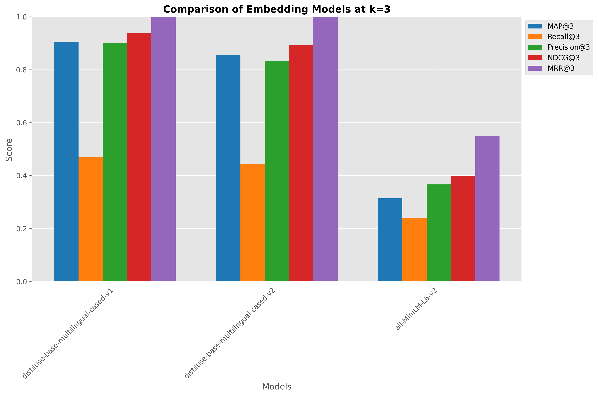
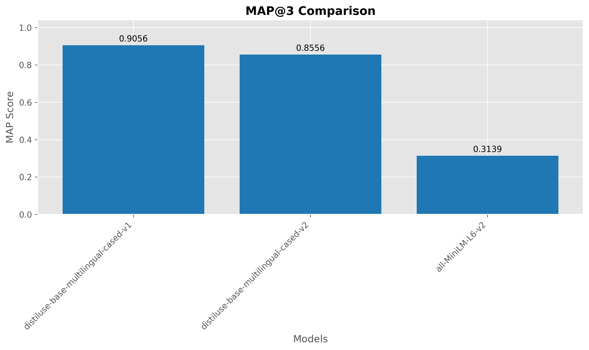
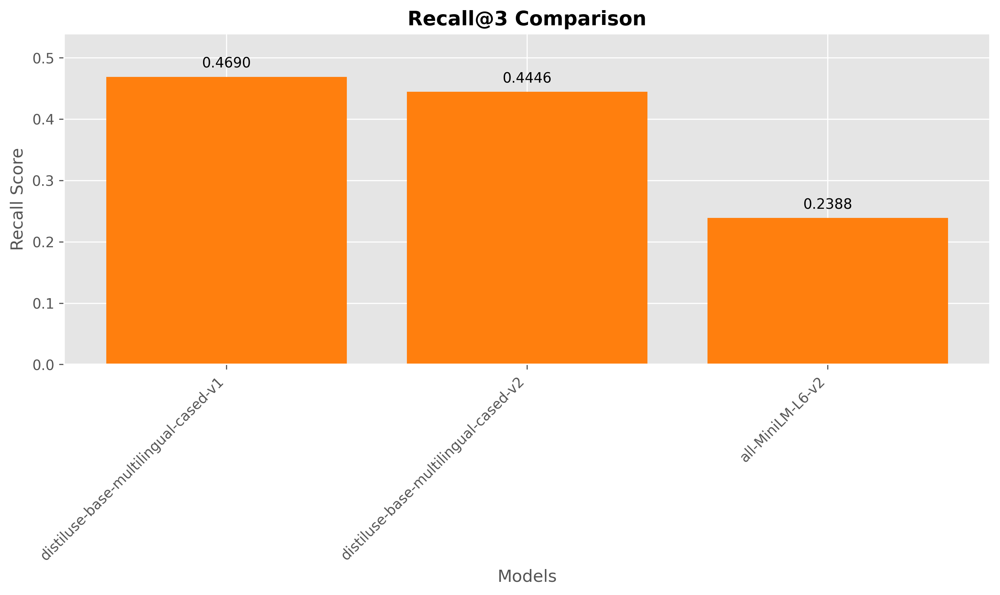
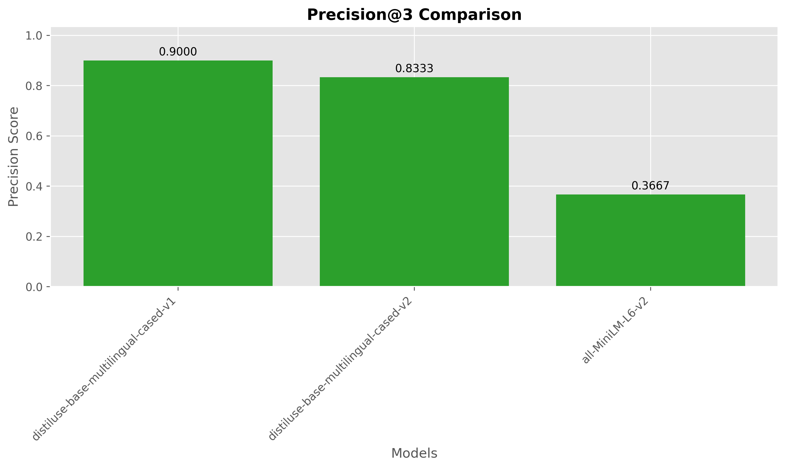
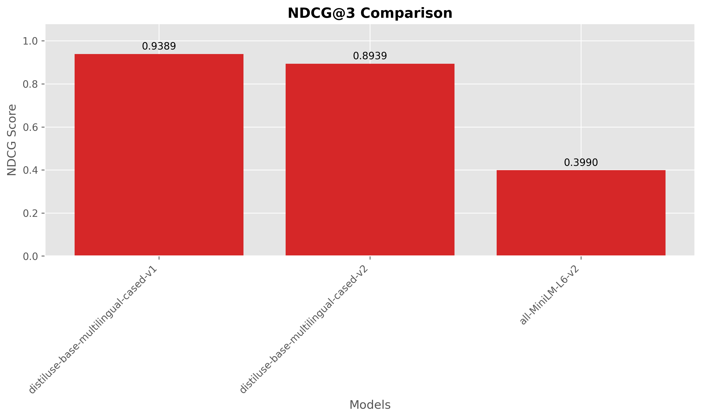
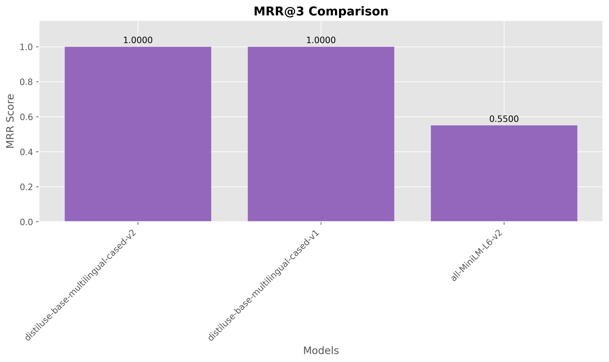

# Embedding Model Benchmark for RAG Retrieval

**Date:** 2025-06-09 23:20:00

## Executive Summary

This report presents a comparative analysis of embedding models for retrieval augmented generation (RAG). The models were evaluated on their ability to retrieve relevant documents using ChromaDB as the vector database. The benchmark used 232 documents and 10 queries with 66 relevant document mappings.

**Best performing model:** sentence-transformers/distiluse-base-multilingual-cased-v1
* MAP@3: 0.9056
* Recall@3: 0.4690
* Precision@3: 0.9000
* NDCG@3: 0.9389
* MRR@3: 1.0000

## Benchmark Configuration

* **k value:** 3
* **Corpus size:** 232 documents
* **Number of queries:** 10 queries
* **Number of relevance judgments:** 66
* **Average relevant docs per query:** 6.60

## Dataset

### Query Examples

| Query ID                           | Text                                                                                                    |   # Relevant Docs |
|:-----------------------------------|:--------------------------------------------------------------------------------------------------------|------------------:|
| q1_seedChunk_SamplePdf_chunk83     | İş planlaması, gerçek zamanlı takip, rota motoru, mikroservis mimarisi, bulut tabanlı altyapı (GCP, ... |                 8 |
| q2_seedChunk_SamplePdf_chunk109    | Sistem mimarisi tasarımı, yapay zeka destekli operasyonel optimizasyon ve raporlama sistemlerinin ge... |                 8 |
| q3_seedChunk_SamplePdf_chunk152    | Proje etkilerinin (istihdam, sektörel katkı, sosyo-kültürel etkiler) ve fikri mülkiyet transfer plan... |                 5 |
| q4_seedChunk_eajm-54-3-248_chunk58 | What are the current applications and challenges of artificial intelligence in medical imaging, spec... |                 6 |
| q5_seedChunk_SamplePdf_chunk128    | Müşteri erişim planı, doğrudan satış, dijital pazarlama ve lojistik firmalarıyla iş birliği strateji... |                 7 |

## Comparative Results

| Model                                                      |   MAP@3 |   Recall@3 |   Precision@3 |   NDCG@3 |   MRR@3 |
|:-----------------------------------------------------------|--------:|-----------:|--------------:|---------:|--------:|
| sentence-transformers/distiluse-base-multilingual-cased-v1 |  0.9056 |     0.469  |        0.9    |   0.9389 |    1    |
| sentence-transformers/distiluse-base-multilingual-cased-v2 |  0.8556 |     0.4446 |        0.8333 |   0.8939 |    1    |
| sentence-transformers/all-MiniLM-L6-v2                     |  0.3139 |     0.2388 |        0.3667 |   0.399  |    0.55 |

## Visualizations

### Model Performance Overview

### Individual Metric Comparisons

#### MAP Comparison

#### RECALL Comparison

#### PRECISION Comparison

#### NDCG Comparison

#### MRR Comparison

## Statistical Significance Analysis

The table below shows the absolute difference between each model pair. Differences greater than 0.05 may be considered significant for practical applications.

### MAP@3 Difference

| Model                                | distiluse-base-multilingual-cased-v1   | distiluse-base-multilingual-cased-v2   | all-MiniLM-L6-v2   |
|:-------------------------------------|:---------------------------------------|:---------------------------------------|:-------------------|
| distiluse-base-multilingual-cased-v1 | —                                      | 0.0500*                                | 0.5917*            |
| distiluse-base-multilingual-cased-v2 | 0.0500*                                | —                                      | 0.5417*            |
| all-MiniLM-L6-v2                     | 0.5917*                                | 0.5417*                                | —                  |

*Note: Values marked with * indicate potentially significant differences (>0.05).*

### RECALL@3 Difference

| Model                                | distiluse-base-multilingual-cased-v1   | distiluse-base-multilingual-cased-v2   | all-MiniLM-L6-v2   |
|:-------------------------------------|:---------------------------------------|:---------------------------------------|:-------------------|
| distiluse-base-multilingual-cased-v1 | —                                      | 0.0244                                 | 0.2302*            |
| distiluse-base-multilingual-cased-v2 | 0.0244                                 | —                                      | 0.2058*            |
| all-MiniLM-L6-v2                     | 0.2302*                                | 0.2058*                                | —                  |

*Note: Values marked with * indicate potentially significant differences (>0.05).*

### PRECISION@3 Difference

| Model                                | distiluse-base-multilingual-cased-v1   | distiluse-base-multilingual-cased-v2   | all-MiniLM-L6-v2   |
|:-------------------------------------|:---------------------------------------|:---------------------------------------|:-------------------|
| distiluse-base-multilingual-cased-v1 | —                                      | 0.0667*                                | 0.5333*            |
| distiluse-base-multilingual-cased-v2 | 0.0667*                                | —                                      | 0.4667*            |
| all-MiniLM-L6-v2                     | 0.5333*                                | 0.4667*                                | —                  |

*Note: Values marked with * indicate potentially significant differences (>0.05).*

### NDCG@3 Difference

| Model                                | distiluse-base-multilingual-cased-v1   | distiluse-base-multilingual-cased-v2   | all-MiniLM-L6-v2   |
|:-------------------------------------|:---------------------------------------|:---------------------------------------|:-------------------|
| distiluse-base-multilingual-cased-v1 | —                                      | 0.0450                                 | 0.5399*            |
| distiluse-base-multilingual-cased-v2 | 0.0450                                 | —                                      | 0.4949*            |
| all-MiniLM-L6-v2                     | 0.5399*                                | 0.4949*                                | —                  |

*Note: Values marked with * indicate potentially significant differences (>0.05).*

### MRR@3 Difference

| Model                                | distiluse-base-multilingual-cased-v1   | distiluse-base-multilingual-cased-v2   | all-MiniLM-L6-v2   |
|:-------------------------------------|:---------------------------------------|:---------------------------------------|:-------------------|
| distiluse-base-multilingual-cased-v1 | —                                      | 0.0000                                 | 0.4500*            |
| distiluse-base-multilingual-cased-v2 | 0.0000                                 | —                                      | 0.4500*            |
| all-MiniLM-L6-v2                     | 0.4500*                                | 0.4500*                                | —                  |

*Note: Values marked with * indicate potentially significant differences (>0.05).*

## Embedding Model Details

### sentence-transformers/distiluse-base-multilingual-cased-v1

* **Collection name:** coll_v1
* **Model dimension:** 512
* **Model type:** SentenceTransformer

### sentence-transformers/all-MiniLM-L6-v2

* **Collection name:** coll_v3
* **Model dimension:** 384
* **Model type:** SentenceTransformer

### sentence-transformers/distiluse-base-multilingual-cased-v2

* **Collection name:** coll_v2
* **Model dimension:** 512
* **Model type:** SentenceTransformer

## Conclusion

Based on the benchmark results, **sentence-transformers/distiluse-base-multilingual-cased-v1** demonstrated the strongest retrieval performance with the highest MAP@3 score of 0.9056. This model significantly outperformed the second-best model (sentence-transformers/distiluse-base-multilingual-cased-v2) by a margin of 0.0500 in MAP@3. 

These results suggest that the choice of embedding model has a substantial impact on retrieval quality. Organizations implementing RAG systems should carefully consider their embedding model selection.

---

*This report was automatically generated by the RAG Retrieval Benchmark tool.*
