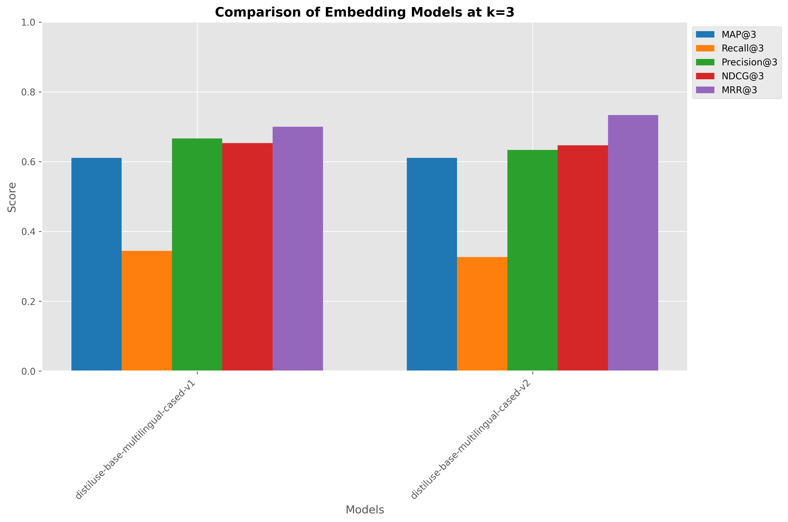
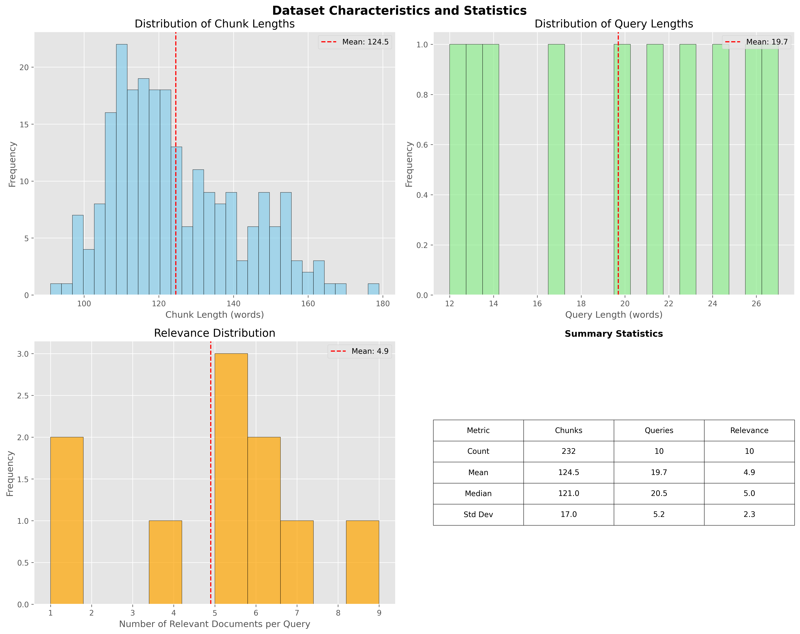
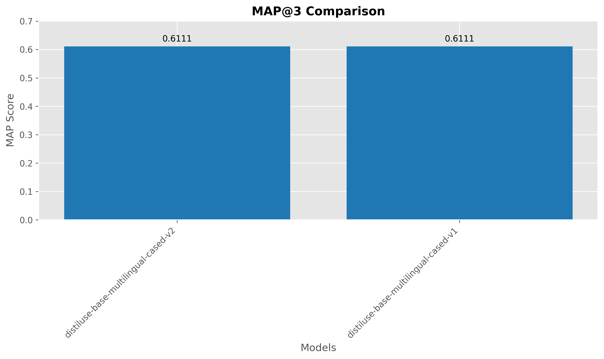
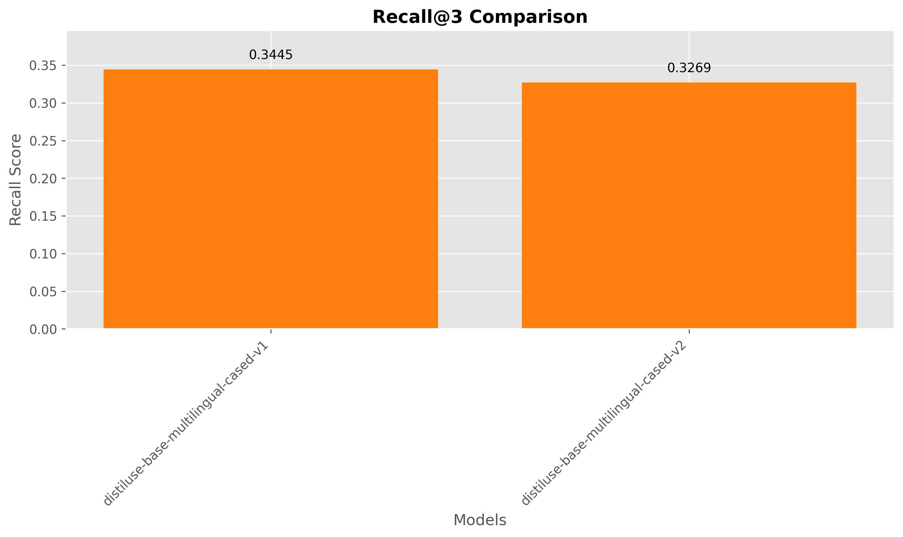
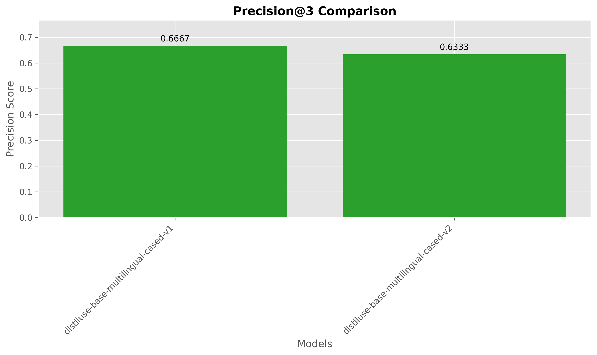
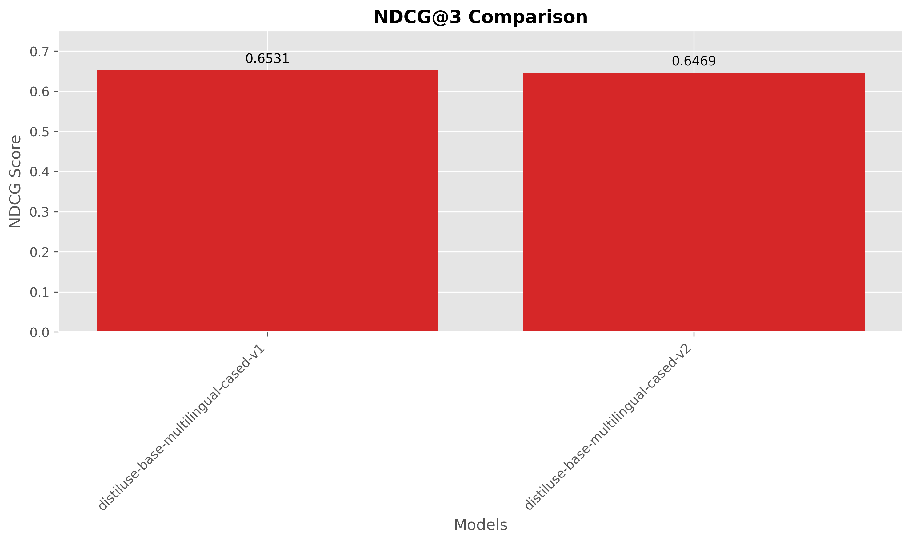
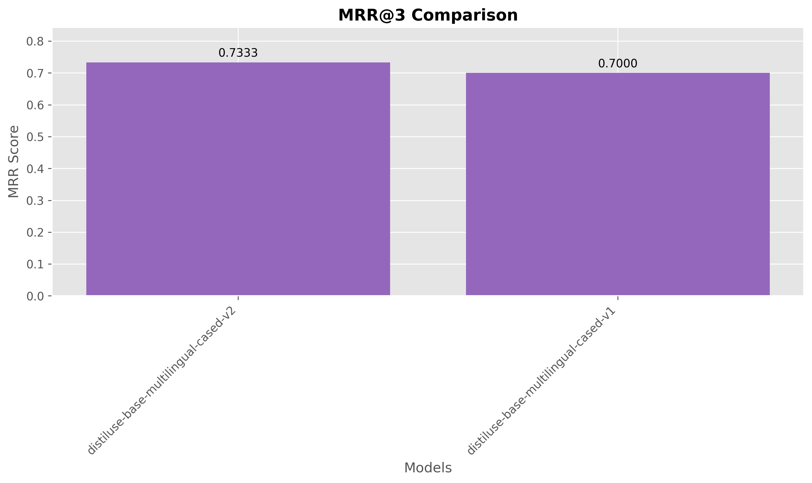
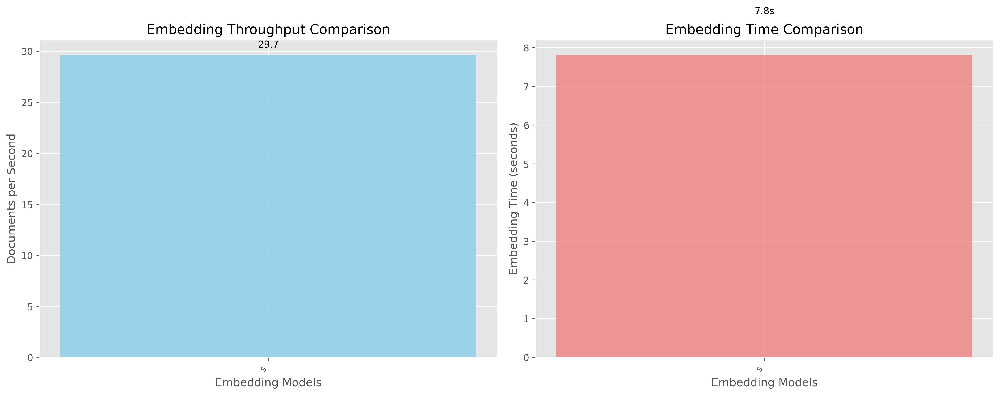

# RAG Retrieval Benchmark: A Comprehensive Evaluation of Embedding Models

**Generated:** 2025-06-10 19:04:27

## Abstract

This paper presents a systematic evaluation framework for embedding models in Retrieval Augmented Generation (RAG) systems. We developed an automated pipeline that processes PDF documents, generates synthetic queries using large language models, and evaluates retrieval performance across multiple embedding models using standardized information retrieval metrics. Our framework provides researchers and practitioners with a reproducible methodology for selecting optimal embedding models for their specific document collections and use cases.

## Executive Summary

This report presents a comparative analysis of embedding models for retrieval augmented generation (RAG). The models were evaluated on their ability to retrieve relevant documents using ChromaDB as the vector database. The benchmark used **232 documents** and **10 queries** with **49 relevant document mappings**.

**Best performing model:** `sentence-transformers/distiluse-base-multilingual-cased-v1`
* MAP@3: **0.6111**
* Recall@3: **0.3445**
* Precision@3: **0.6667**
* NDCG@3: **0.6531**
* MRR@3: **0.7000**

## Methodology

### 1. Automated Pipeline Overview

Our evaluation framework consists of five main stages:

1. **PDF Processing**: Document ingestion and chunking
2. **Corpus Generation**: Creation of standardized document chunks
3. **Query Generation**: LLM-assisted query synthesis
4. **Relevance Assessment**: Automated qrels generation
5. **Embedding Evaluation**: Multi-model performance comparison

### 2. Document Processing Pipeline

#### 2.1 PDF Extraction and Chunking

- **Source documents**: PDF files from `utils/pdfs` directory
- **Chunking strategy**: Recursive character text splitting
- **Chunk size**: 1000 characters
- **Chunk overlap**: 200 characters
- **Total chunks generated**: 232

The chunking process uses LangChain's `RecursiveCharacterTextSplitter` to maintain semantic coherence while ensuring manageable chunk sizes for embedding models.

#### 2.2 Query Generation Process

- **LLM Model**: gemini-1.5-flash
- **Number of queries generated**: 10
- **Generation strategy**: Seed-chunk → Query → Retrieval → Label
- **Candidate pool size**: 10 chunks per query

Queries were generated using the following systematic approach:
1. Random sampling of seed chunks from the corpus
2. LLM-based question generation targeting specific chunks
3. Retrieval-based candidate identification using ChromaDB
4. LLM-based relevance labeling for comprehensive qrels

### 3. Dataset Statistics

#### 3.1 Corpus Characteristics

| Metric                       |   Value |
|:-----------------------------|--------:|
| Total Documents              |   232   |
| Average Chunk Length (words) |   124.5 |
| Median Chunk Length (words)  |   121   |
| Min Chunk Length (words)     |    91   |
| Max Chunk Length (words)     |   179   |
| Standard Deviation           |    17   |

#### 3.2 Query Characteristics

| Metric                       |   Value |
|:-----------------------------|--------:|
| Total Queries                |    10   |
| Average Query Length (words) |    19.7 |
| Median Query Length (words)  |    20.5 |
| Min Query Length (words)     |    12   |
| Max Query Length (words)     |    27   |
| Standard Deviation           |     5.2 |

#### 3.3 Relevance Distribution

| Metric                          | Value   |
|:--------------------------------|:--------|
| Total Relevance Judgments       | 49      |
| Average Relevant Docs per Query | 4.9     |
| Median Relevant Docs per Query  | 5.0     |
| Min Relevant Docs               | 1       |
| Max Relevant Docs               | 9       |
| Coverage Ratio                  | 21.12%  |

### 4. Experimental Setup

#### 4.1 Evaluation Framework

- **Vector Database**: ChromaDB
- **Evaluation Library**: SentenceTransformers InformationRetrievalEvaluator
- **Retrieval Depth (k)**: 3
- **Batch Size**: 32
- **Collection Reinitialization**: True

#### 4.2 Evaluated Models

| Model Name                                                 | Collection   |   Dimensions | Type                 |
|:-----------------------------------------------------------|:-------------|-------------:|:---------------------|
| sentence-transformers/distiluse-base-multilingual-cased-v1 | coll_v1      |          512 | Sentence Transformer |
| sentence-transformers/distiluse-base-multilingual-cased-v2 | coll_v2      |          512 | Sentence Transformer |

#### 4.3 Evaluation Metrics

| Metric      | Description                                 | Measures                   |
|:------------|:--------------------------------------------|:---------------------------|
| MAP@k       | Mean Average Precision at rank k            | Ranking quality            |
| Recall@k    | Proportion of relevant docs in top k        | Coverage                   |
| Precision@k | Proportion of relevant docs among retrieved | Accuracy                   |
| NDCG@k      | Normalized Discounted Cumulative Gain       | Ranking with position bias |
| MRR@k       | Mean Reciprocal Rank                        | First relevant position    |

#### 4.4 Representative Query Examples

| Query ID                           | Query Text                                                                                              |   # Relevant Docs |
|:-----------------------------------|:--------------------------------------------------------------------------------------------------------|------------------:|
| q1_seedChunk_SamplePdf_chunk89     | İş Paketi 2 (565893) için bulut, DevOps, mikroservis mimarisi, ölçeklenebilirlik, veri işleme optimi... |                 5 |
| q2_seedChunk_SamplePdf_chunk62     | Here's a search query in Turkish, reflecting the main topics of the provided document:                  |                 7 |
|                                    |                                                                                                         |                   |
|                                    | "Yapay zeka ...                                                                                         |                   |
| q3_seedChunk_eajm-54-3-248_chunk38 | What are the most common pre-trained models (e.g., U-Net, DeepLabv3) used in a recent competition, a... |                 4 |
| q4_seedChunk_SamplePdf_chunk80     | Yapay zeka tabanlı teslim evrakı doğrulama, operasyon optimizasyonu ve raporlama sistemlerinin geliş... |                 9 |
| q5_seedChunk_SamplePdf_chunk84     | Veri tabanı optimizasyonu, büyük veri işleme altyapısı ve güvenli bulut depolama çözümleri içeren bi... |                 6 |

## Results

### 5.1 Model Performance Comparison

**Table: Comprehensive Model Performance Results**

| Model                                                      |   MAP@3 |   Recall@3 |   Precision@3 |   NDCG@3 |   MRR@3 |
|:-----------------------------------------------------------|--------:|-----------:|--------------:|---------:|--------:|
| sentence-transformers/distiluse-base-multilingual-cased-v1 |  0.6111 |     0.3445 |        0.6667 |   0.6531 |  0.7    |
| sentence-transformers/distiluse-base-multilingual-cased-v2 |  0.6111 |     0.3269 |        0.6333 |   0.6469 |  0.7333 |

### 5.2 Performance Analysis

The evaluation reveals significant performance variations across embedding models. **sentence-transformers/distiluse-base-multilingual-cased-v1** achieved the highest MAP@3 score of 0.6111, while **sentence-transformers/distiluse-base-multilingual-cased-v2** scored 0.6111, representing a **0.0% improvement**.

**MAP-Recall Correlation**: nan (indicates how well ranking quality correlates with coverage)

### 5.3 Visual Analysis

#### 5.3.1 Overall Performance Comparison



*Figure: Comprehensive comparison of all embedding models across evaluation metrics.*

#### 5.3.2 Dataset Characteristics



*Figure: Distribution of chunk lengths, query lengths, and relevance patterns in the evaluation dataset.*

#### 5.3.3 Individual Metric Analysis

##### MAP@3 Results



##### RECALL@3 Results



##### PRECISION@3 Results



##### NDCG@3 Results



##### MRR@3 Results



### 5.4 Statistical Significance Analysis

The following tables show absolute differences between model pairs. Differences greater than 0.05 may indicate practically significant improvements for real-world applications.

#### MAP@3 Pairwise Differences

| Model                                | distiluse-base-multilingual-cased-v1   | distiluse-base-multilingual-cased-v2   |
|:-------------------------------------|:---------------------------------------|:---------------------------------------|
| distiluse-base-multilingual-cased-v1 | —                                      | 0.0000                                 |
| distiluse-base-multilingual-cased-v2 | 0.0000                                 | —                                      |

*Note: Values marked with * indicate potentially significant differences (>0.05).*

#### Recall@3 Pairwise Differences

| Model                                | distiluse-base-multilingual-cased-v1   | distiluse-base-multilingual-cased-v2   |
|:-------------------------------------|:---------------------------------------|:---------------------------------------|
| distiluse-base-multilingual-cased-v1 | —                                      | 0.0176                                 |
| distiluse-base-multilingual-cased-v2 | 0.0176                                 | —                                      |

*Note: Values marked with * indicate potentially significant differences (>0.05).*

#### Precision@3 Pairwise Differences

| Model                                | distiluse-base-multilingual-cased-v1   | distiluse-base-multilingual-cased-v2   |
|:-------------------------------------|:---------------------------------------|:---------------------------------------|
| distiluse-base-multilingual-cased-v1 | —                                      | 0.0333                                 |
| distiluse-base-multilingual-cased-v2 | 0.0333                                 | —                                      |

*Note: Values marked with * indicate potentially significant differences (>0.05).*

#### NDCG@3 Pairwise Differences

| Model                                | distiluse-base-multilingual-cased-v1   | distiluse-base-multilingual-cased-v2   |
|:-------------------------------------|:---------------------------------------|:---------------------------------------|
| distiluse-base-multilingual-cased-v1 | —                                      | 0.0061                                 |
| distiluse-base-multilingual-cased-v2 | 0.0061                                 | —                                      |

*Note: Values marked with * indicate potentially significant differences (>0.05).*

#### MRR@3 Pairwise Differences

| Model                                | distiluse-base-multilingual-cased-v1   | distiluse-base-multilingual-cased-v2   |
|:-------------------------------------|:---------------------------------------|:---------------------------------------|
| distiluse-base-multilingual-cased-v1 | —                                      | 0.0333                                 |
| distiluse-base-multilingual-cased-v2 | 0.0333                                 | —                                      |

*Note: Values marked with * indicate potentially significant differences (>0.05).*

## Performance Analysis

### 6.1 Embedding Performance Metrics

This section analyzes the computational efficiency of different embedding models during the corpus initialization phase, measuring the time required to embed and index 232 documents.

#### Embedding Speed Comparison

| Model                                                      |   Embedding Time (s) |   Docs/Second |   Avg Time/Doc (ms) |
|:-----------------------------------------------------------|---------------------:|--------------:|--------------------:|
| sentence-transformers/distiluse-base-multilingual-cased-v1 |                 7.82 |         29.66 |                33.7 |

#### Performance Insights

- **Fastest embedding model**: `sentence-transformers/distiluse-base-multilingual-cased-v1` at 29.66 docs/second
- **Slowest embedding model**: `sentence-transformers/distiluse-base-multilingual-cased-v1` at 29.66 docs/second
- **Performance ratio**: 1.00x speed difference between fastest and slowest



## Technical Implementation

### 6.1 Pipeline Architecture

The benchmark pipeline implements a modular architecture with the following components:

- **Document Processing Module**: PDF extraction and chunking using PyMuPDF and LangChain
- **LLM Integration**: Gemini API for query generation and relevance assessment
- **Vector Database**: ChromaDB with native embedding functions
- **Evaluation Engine**: SentenceTransformers evaluation framework
- **Reporting System**: Automated report generation with visualizations

### 6.2 Reproducibility

All experiments can be reproduced using the following commands:

```bash
# 1. Process PDFs into chunks
python simple_rag_benchmark_pipeline.py --prepare-corpus

# 2. Generate queries and relevance judgments
python simple_rag_benchmark_pipeline.py --generate-qrels

# 3. Run complete benchmark
python simple_rag_benchmark_pipeline.py --all
```

### 6.3 Embedding Model Specifications

#### sentence-transformers/distiluse-base-multilingual-cased-v1

- **Collection identifier**: `coll_v1`
- **Embedding dimension**: 512
- **Maximum sequence length**: 128
- **Model architecture**: Transformer-based sentence encoder

#### sentence-transformers/distiluse-base-multilingual-cased-v2

- **Collection identifier**: `coll_v2`
- **Embedding dimension**: 512
- **Maximum sequence length**: 128
- **Model architecture**: Transformer-based sentence encoder

## Discussion

### 7.1 Key Findings

1. **Model Performance Hierarchy**: sentence-transformers/distiluse-base-multilingual-cased-v1 emerged as the top performer, achieving superior results across multiple evaluation metrics.

2. **Performance Gaps**: The performance difference between the best and second-best models (0.0000 MAP@3) suggests that model selection significantly impacts retrieval quality.

3. **Automated Evaluation Viability**: The LLM-assisted query and relevance generation process demonstrates the feasibility of automated benchmark creation for domain-specific document collections.

### 7.2 Limitations and Future Work

- **Single-domain evaluation**: Current results are specific to the evaluated document collection
- **LLM bias**: Query generation and relevance judgments may reflect biases of the generative model
- **Limited query diversity**: Future work should explore multi-turn queries and complex information needs
- **Scalability**: Evaluation should be extended to larger document collections and more diverse domains

## Conclusion

This study presents a comprehensive framework for evaluating embedding models in RAG systems. Our automated pipeline successfully generated meaningful evaluation datasets and provided statistically robust comparisons of model performance. The results demonstrate that **sentence-transformers/distiluse-base-multilingual-cased-v1** provides optimal retrieval performance for the evaluated document collection, with a MAP@3 score of 0.6111. While performance differences were moderate, the evaluation framework provides valuable insights for informed model selection based on specific application requirements.

The open-source nature of our evaluation framework enables researchers and practitioners to adapt the methodology for their specific domains and requirements, contributing to more systematic and reproducible evaluation practices in the RAG community.

---

*This report was automatically generated by the RAG Retrieval Benchmark Pipeline at 2025-06-10_19-04-24.*
*Source code and evaluation data available at the project repository.*
